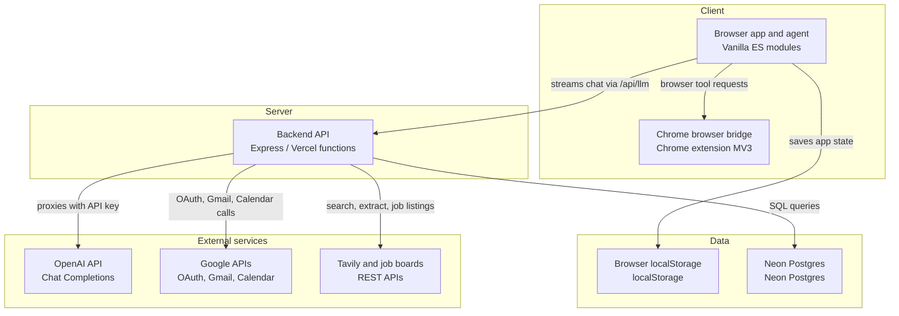

# Architecture

Repository: https://github.com/lngsa1234/mini-muse-mvp · Mapped: 2026-11-18 · By Alex (Technical Lead)

Mini Muse is a no-build browser app plus a thin Node/Express backend, with matching Vercel functions for deployment. The agent loop runs in the browser. It streams chat through the backend's LLM proxy to OpenAI and runs tools locally or through the backend's API routes. The backend reads and writes Neon Postgres, calls Google, Tavily and public job boards, and a Chrome extension lets the agent drive real browser tabs.

## Components

### Client

- **Browser app and agent** (Vanilla ES modules): Chat UI, feature pages (ideas, goals, jobs, library, connectors, settings) and the in-browser tool-use agent loop, with approvals and check-ins; chat, memory and prefs persist in localStorage. — `public/js/main.js`, `public/js/agent`, `public/js/features`, `public/js/workflow`
- **Chrome browser bridge** (Chrome extension MV3): Relays agent requests from the Muse page to other tabs. It can open URLs and read or fill pages through an injected content script, after the user grants site permission. — `chrome-extension/background.js`, `chrome-extension/muse-bridge.js`, `chrome-extension/target.js`

### Server

- **Backend API** (Express / Vercel functions): Serves static files and handles the LLM proxy, docs, ideas, goals, web search, jobs search, Google OAuth, Gmail and Calendar routes, and trace ingest. — `server/index.js`, `api`, `server/proxy.js`, `server/google.js`

### Data

- **Browser localStorage** (localStorage): Holds chat history, memory, preferences and other app state that is not stored in the database. — `public/js/core/storage.js`, `public/js/core/state.js`
- **Neon Postgres** (Neon Postgres): Stores documents, ideas, goals with their applications, and trace spans per user. — `server/db.js`, `db/schema.sql`, `scripts/db-init.mjs`

### External services

- **OpenAI API** (Chat Completions): Model provider that streams the agent's replies.
- **Google APIs** (OAuth, Gmail, Calendar): Handles OAuth and provides Gmail and Calendar access; the backend keeps the tokens in an encrypted cookie.
- **Tavily and job boards** (REST APIs): Tavily provides web search and page extraction, and public job boards provide listings.

## Connections

- Browser app and agent → Backend API: streams chat via /api/llm
- Browser app and agent → Browser localStorage: saves app state
- Browser app and agent → Chrome browser bridge: browser tool requests
- Backend API → OpenAI API: proxies with API key
- Backend API → Neon Postgres: SQL queries
- Backend API → Google APIs: OAuth, Gmail, Calendar calls
- Backend API → Tavily and job boards: search, extract, job listings

## Not confirmed

- I did not read the Vercel api/*.js wrappers, vercel.json, the rest of server/jobs.js or server/web.js, or the extension content scripts. I assumed the Vercel functions mirror server/index.js, as the docs and its header comments say.
- I did not confirm which job boards server/jobs.js calls. The docs name Greenhouse, Lever and Ashby.
- I did not trace how the Library extracts uploaded text in server/extract.js.
- I left observability out of the diagram, though trace spans are written to the database.
