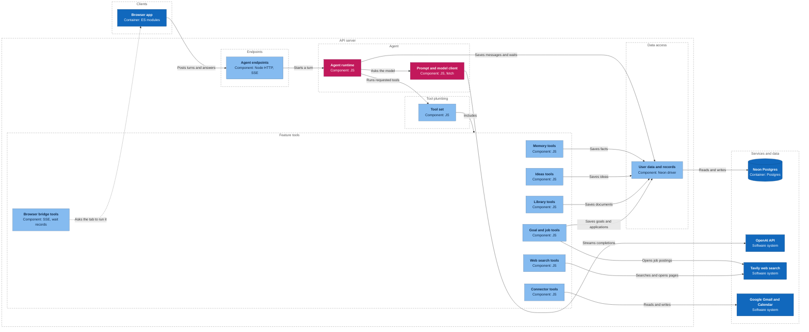

# Inside API server — Mini Muse

Repository: https://github.com/lngsa1234/mini-muse-mvp · Mapped: 2026-11-22 · Mapped by Alex from the code (C4 model)

C4 level 3: the components inside API server, with the agent kept apart from each feature’s tools, and how every feature works with the agent. The surrounding containers are in [Containers](c4-containers.md).

## Components

| Component | Kind | What it does | Code |
|---|---|---|---|
| Agent endpoints | Endpoints | Turn, answer, cancel and state endpoints; streams turn events to the page. | `server/agent/http.js`, `api/agent.js`, `server/state.js` |
| Agent runtime | Agent | Runs one turn at a time per user: shortcuts, the tool loop up to 12 steps, approvals and browser-tool waits, and Stop. | `server/agent/runtime.js`, `server/agent/loop.js` |
| Prompt and model client | Agent | Builds the prompt from saved data and calls the model with the server-held key and a model picked by tier. | `server/agent/prompt.js`, `server/agent/llm.js`, `server/routing.js` |
| Tool set | Tool plumbing | Collects the tools of each feature and of the connected services for a turn. | `server/agent/tools/index.js`, `server/agent/tools/schema.js` |
| Goal and job tools | Feature tools | create_goal, update_step, revise_plan, track_application, jobs_search and score_fit, with the evidence rules. | `server/agent/tools/goals.js`, `server/agent/tools/jobs.js` |
| Library tools | Feature tools | docs_search, docs_read, docs_add and docs_remove. | `server/agent/tools/library.js` |
| Ideas tools | Feature tools | save_idea. | `server/agent/tools/ideas.js` |
| Connector tools | Feature tools | Gmail, Calendar and Contacts tools; writes ask for approval. | `server/agent/tools/connectors.js` |
| Memory tools | Feature tools | remember and forget, saved with the user’s state. | `server/agent/tools/memory.js` |
| Web search tools | Feature tools | web_search and web_open, through Tavily. | `server/agent/tools/web.js` |
| Browser bridge tools | Feature tools | browser_open, browser_snapshot, browser_fields, browser_fill and browser_click (asks first); each runs in the tab that started the turn, which waits for the result. | `server/agent/tools/browser.js` |
| User data and records | Data access | Chat, state, waits and the activity log, plus the goals, docs and ideas handlers. | `server/userdata.js`, `server/agent/repo.js`, `server/goals.js`, `server/docs.js`, `server/ideas.js` |

## How they talk

- Browser app → Agent endpoints: Posts turns and answers (HTTPS/SSE)
- Agent endpoints → Agent runtime: Starts a turn (function call)
- Agent runtime → Prompt and model client: Asks the model (function call)
- Prompt and model client → OpenAI API: Streams completions (HTTPS/SSE)
- Agent runtime → Tool set: Runs requested tools (function call)
- Tool set → Goal and job tools: Includes
- Tool set → Library tools: Includes
- Tool set → Ideas tools: Includes
- Tool set → Connector tools: Includes
- Tool set → Memory tools: Includes
- Tool set → Web search tools: Includes
- Tool set → Browser bridge tools: Includes
- Browser bridge tools → Browser app: Asks the tab to run it (SSE)
- Goal and job tools → User data and records: Saves goals and applications (function call)
- Library tools → User data and records: Saves documents (function call)
- Ideas tools → User data and records: Saves ideas (function call)
- Memory tools → User data and records: Saves facts (function call)
- Connector tools → Google Gmail and Calendar: Reads and writes (OAuth 2.0/HTTPS)
- Web search tools → Tavily web search: Searches and opens pages (HTTPS)
- Goal and job tools → Tavily web search: Opens job postings (HTTPS)
- Agent runtime → User data and records: Saves messages and waits (function call)
- User data and records → Neon Postgres: Reads and writes (SQL)

## How each feature works with the agent

### Agent chat

- **Feature → agent:** Submitting the composer, example chips or a feature button posts the message to /api/agent/turn.
- **The agent:** The agent runtime saves the message, runs the tool loop on the server, waits for approvals and browser tools, and saves the reply as it streams.
- **Agent → feature:** The page shows streamed text, tool chips and approval cards; if the stream drops it polls /api/state until the reply is finished, on any device.

| Tool | Effect | Needs approval |
|---|---|---|
| `browser_fill` | Fills form fields in the Chrome tab | no |
| `browser_click` | Clicks a button, including Submit | yes |

Code: `public/js/agent/run.js`, `public/js/features/chat/chat.js`, `server/agent/runtime.js`, `server/agent/http.js`

### Library

- **Feature → agent:** Questions about notes, or goal steps that need a résumé, call the docs tools; the page adds and deletes documents through the API.
- **The agent:** Searches and reads documents and saves or removes notes, citing the source.
- **Agent → feature:** The Library list reloads after the turn changes it.

| Tool | Effect | Needs approval |
|---|---|---|
| `docs_search` | Searches documents | no |
| `docs_read` | Reads a document | no |
| `docs_add` | Saves a document | no |
| `docs_remove` | Deletes a document | no |

Code: `server/agent/tools/library.js`, `public/js/features/library/library.js`, `server/docs.js`

### Ideas

- **Feature → agent:** Do it sends the idea to chat; Make it a goal sends a plan request.
- **The agent:** Saves ideas shared in chat and acts on or plans an idea.
- **Agent → feature:** The Ideas page reloads its cards after the turn.

| Tool | Effect | Needs approval |
|---|---|---|
| `save_idea` | Creates an idea | no |

Code: `server/agent/tools/ideas.js`, `public/js/features/ideas/ideas.js`, `server/ideas.js`

### Goals

- **Feature → agent:** The goal form and Ask Muse to move this forward send chat messages; the open app starts the daily check-in.
- **The agent:** Creates plans, moves steps only with tool evidence from the same turn (enforced on the server), revises plans with approval, and tracks applications with proof.
- **Agent → feature:** Goal cards reload with step status, progress, target and applications.

| Tool | Effect | Needs approval |
|---|---|---|
| `create_goal` | Creates a goal with steps, target and deadline | no |
| `update_step` | Sets a step’s status, with tool evidence | no |
| `revise_plan` | Rewords, adds or removes steps | yes |
| `track_application` | Adds or updates a job application | no |

Code: `server/agent/tools/goals.js`, `server/agent/tools/jobs.js`, `public/js/features/goals/goals.js`, `public/js/workflow/checkin.js`

### Connectors

- **Feature → agent:** The user asks about email, calendar or contacts; connected services add their tools to the turn.
- **The agent:** Searches and reads Gmail, sends mail, manages Calendar events and looks up contacts; writes ask first.
- **Agent → feature:** Chat shows tool chips and approval cards; the Connectors page shows connection and permissions.

| Tool | Effect | Needs approval |
|---|---|---|
| `mail_search` | Searches Gmail | no |
| `mail_send` | Sends an email | yes |
| `calendar_add` | Adds an event | yes |

Code: `server/agent/tools/connectors.js`, `public/js/features/connectors/index.js`, `server/google.js`

