# Inside Browser app — Mini Muse

Repository: https://github.com/lngsa1234/mini-muse-mvp · Mapped: 2026-11-18 · Mapped by Alex from the code (C4 model)

C4 level 3: the components inside Browser app, with the agent kept apart from each feature’s UI, and how every feature works with the agent. The surrounding containers are in [Containers](c4-containers.md).

```mermaid
C4Component
  title Components of Browser app
  Container_Boundary(browser_app_b, "Browser app") {
    Component(shell, "App shell and registry", "ES modules", "Boots all features, routes clicks and submits, and renders pages from registered")
    Component(agent_loop, "Agent loop", "JS, SSE", "Runs a chat turn: builds the prompt, streams from /api/llm, executes requested t")
    Component(tool_registry, "Tool registry", "JS", "Collects tools from features and connected connectors and wraps each to show pro")
    Component(approvals, "Approvals", "JS", "Shows approval cards in chat and resolves the tool's ask when the user allows or")
    Component(client_state, "State, memory and audit", "localStorage, fetch", "Holds app state, activity audit, traces and the API client that syncs with the s")
    Component(chat_feature, "Agent Chat feature", "ES module", "Chat log, composer and approval cards; sends messages to the agent.")
    Component(library_feature, "Library feature", "ES module", "Document list, upload and keyword search, with docs_* tools.")
    Component(ideas_feature, "Ideas feature", "ES module", "Starter and Muse-generated ideas, with the save_idea tool.")
    Component(goals_feature, "Goals feature", "ES module", "Goal plans, targets, application tracker and evidence-gated goal tools; also che")
    Component(connectors_feature, "Connectors feature", "ES module", "Connectors page and Gmail, Calendar and Contacts tools.")
    Component(browser_bridge, "Browser bridge tools", "postMessage", "browser_* tools that relay requests to the Chrome extension.")
  }
  Container(api_server, "API server", "Express / Vercel functions", "Serves static files and the handlers for the LLM proxy, docs, ideas, goals, web ")
  Container(chrome_extension, "Chrome Browser Bridge", "Chrome extension", "Optional extension that opens, reads, fills and clicks in a job application tab ")
  Rel(chat_feature, agent_loop, "Sends user message", "function call")
  Rel(library_feature, tool_registry, "Registers docs tools", "defineFeature")
  Rel(ideas_feature, tool_registry, "Registers save_idea", "defineFeature")
  Rel(goals_feature, tool_registry, "Registers goal tools", "defineFeature")
  Rel(connectors_feature, tool_registry, "Registers connector tools", "defineConnector")
  Rel(browser_bridge, tool_registry, "Registers browser tools", "defineFeature")
  Rel(ideas_feature, agent_loop, "Asks Muse to do or plan", "function call")
  Rel(goals_feature, agent_loop, "Asks Muse to advance goal", "function call")
  Rel(agent_loop, tool_registry, "Executes requested tools", "function call")
  Rel(tool_registry, approvals, "Requests user approval", "promise")
  Rel(approvals, chat_feature, "Renders approval card", "state render")
  Rel(agent_loop, api_server, "Streams completions", "HTTPS/SSE")
  Rel(tool_registry, client_state, "Saves state and audit", "function call")
  Rel(client_state, api_server, "Syncs docs, ideas, goals", "HTTPS/JSON")
  Rel(browser_bridge, chrome_extension, "Sends browser commands", "window.postMessage")
  Rel(shell, chat_feature, "Renders registered pages", "function call")
```

## Components

| Component | Kind | What it does | Code |
|---|---|---|---|
| App shell and registry | App shell | Boots all features, routes clicks and submits, and renders pages from registered features and connectors. | `public/js/main.js`, `public/js/core/registry.js`, `public/js/core/nav.js` |
| Agent loop | Agent | Runs a chat turn: builds the prompt, streams from /api/llm, executes requested tools and repeats, with intent guards for applying and job research. | `public/js/agent/run.js`, `public/js/agent/loop.js`, `public/js/agent/prompt.js`, `public/js/agent/transport.js` |
| Tool registry | Tools | Collects tools from features and connected connectors and wraps each to show progress, audit, save and re-render. | `public/js/agent/tools.js`, `public/js/core/registry.js` |
| Approvals | Agent | Shows approval cards in chat and resolves the tool's ask when the user allows or declines. | `public/js/workflow/approvals.js`, `public/js/agent/policy.js` |
| State, memory and audit | Client state | Holds app state, activity audit, traces and the API client that syncs with the server. | `public/js/core/state.js`, `public/js/core/storage.js`, `public/js/core/api.js`, `public/js/core/activity.js` |
| Agent Chat feature | Feature UI | Chat log, composer and approval cards; sends messages to the agent. | `public/js/features/chat/chat.js` |
| Library feature | Feature UI | Document list, upload and keyword search, with docs_* tools. | `public/js/features/library/library.js`, `public/js/features/library/search.js` |
| Ideas feature | Feature UI | Starter and Muse-generated ideas, with the save_idea tool. | `public/js/features/ideas/ideas.js`, `public/js/features/ideas/rules.js` |
| Goals feature | Feature UI | Goal plans, targets, application tracker and evidence-gated goal tools; also check-in and job tools. | `public/js/features/goals/goals.js`, `public/js/workflow/checkin.js`, `public/js/features/jobs/jobs.js` |
| Connectors feature | Feature UI | Connectors page and Gmail, Calendar and Contacts tools. | `public/js/features/connectors/index.js`, `public/js/features/connectors/mail.js`, `public/js/features/connectors/calendar.js` |
| Browser bridge tools | Tools | browser_* tools that relay requests to the Chrome extension. | `public/js/features/browser/browser.js` |

## How they talk

- Agent Chat feature → Agent loop: Sends user message (function call)
- Library feature → Tool registry: Registers docs tools (defineFeature)
- Ideas feature → Tool registry: Registers save_idea (defineFeature)
- Goals feature → Tool registry: Registers goal tools (defineFeature)
- Connectors feature → Tool registry: Registers connector tools (defineConnector)
- Browser bridge tools → Tool registry: Registers browser tools (defineFeature)
- Ideas feature → Agent loop: Asks Muse to do or plan (function call)
- Goals feature → Agent loop: Asks Muse to advance goal (function call)
- Agent loop → Tool registry: Executes requested tools (function call)
- Tool registry → Approvals: Requests user approval (promise)
- Approvals → Agent Chat feature: Renders approval card (state render)
- Agent loop → API server: Streams completions (HTTPS/SSE)
- Tool registry → State, memory and audit: Saves state and audit (function call)
- State, memory and audit → API server: Syncs docs, ideas, goals (HTTPS/JSON)
- Browser bridge tools → Chrome Browser Bridge: Sends browser commands (window.postMessage)
- App shell and registry → Agent Chat feature: Renders registered pages (function call)

## How each feature works with the agent

### Library

- **Feature → agent:** Chat questions about notes or goal steps needing a résumé call docs tools; the page form adds or deletes documents through the API directly.
- **The agent:** Searches the Library, reads documents and saves or removes notes, citing the source document; docs_search results also serve as proof for résumé goal steps.
- **Agent → feature:** state.docs is updated and the Library list re-renders with the new count.

| Tool | Effect | Needs approval |
|---|---|---|
| `docs_search` | Keyword search of documents | no |
| `docs_read` | Reads a document's first 6000 characters | no |
| `docs_add` | Saves a document to Neon | no |
| `docs_remove` | Deletes a document | no |

Code: `public/js/features/library/library.js`, `public/js/features/library/search.js`, `public/js/core/api.js`, `server/docs.js`

### Ideas

- **Feature → agent:** The Do it button sends a chat message with the idea; Make it a goal sends a plan request; Update with Muse runs a one-shot JSON completion.
- **The agent:** Saves ideas shared in chat and acts on or plans an idea; a separate JSON completion creates personalized ideas.
- **Agent → feature:** The idea is added to state.ideas and cards re-render under New, Saved or Acted on.

| Tool | Effect | Needs approval |
|---|---|---|
| `save_idea` | Creates an idea on the Ideas page | no |

Code: `public/js/features/ideas/ideas.js`, `public/js/features/ideas/rules.js`, `server/ideas.js`

### Goals

- **Feature → agent:** The goal form sends 'New goal: …' to chat; Ask Muse to move this forward sends a nudge message; the daily check-in runs the agent in the background.
- **The agent:** Creates plans, updates step status only with tool evidence from this turn, revises plans, and tracks job applications with proof such as an approved submit or a confirmation email. Job tools search hiring sites and score fit.
- **Agent → feature:** The goal is replaced in state.plans and the card re-renders with step status, progress bar, target and application list.

| Tool | Effect | Needs approval |
|---|---|---|
| `create_goal` | Creates goal with steps, target and deadline | no |
| `update_step` | Sets step status, requires tool evidence | no |
| `revise_plan` | Rewords, adds or removes steps | yes |
| `track_application` | Adds or updates a job application | no |

Code: `public/js/features/goals/goals.js`, `public/js/features/goals/model.js`, `public/js/workflow/checkin.js`, `public/js/agent/run.js`, `server/goals.js`

### Connectors

- **Feature → agent:** The user asks in chat about email, calendar or contacts; a connected connector's tools become available to the agent.
- **The agent:** Searches and reads Gmail, sends mail, lists, adds and removes Calendar events, and looks up contacts. Write tools ask first.
- **Agent → feature:** Chat shows connector tool chips and approval cards; the Connectors page shows connected state and permissions.

| Tool | Effect | Needs approval |
|---|---|---|
| `mail_search` | Searches Gmail | no |
| `mail_read` | Reads a Gmail message | no |
| `mail_send` | Sends an email | yes |
| `calendar_list` | Lists events | no |
| `calendar_add` | Adds an event | yes |
| `calendar_remove` | Removes an event | yes |

Code: `public/js/features/connectors/mail.js`, `public/js/features/connectors/calendar.js`, `public/js/features/connectors/contacts.js`, `server/google.js`

### Agent Chat

- **Feature → agent:** Submitting the composer, example chips or any feature button calls say().
- **The agent:** Runs the streaming tool-use loop against the model through /api/llm, executes registered tools, pauses for approvals, and answers. It also drives the optional browser tools to read, fill and click on application forms.
- **Agent → feature:** The assistant message streams in with tool-action chips and approval cards, with the status shown while thinking.

| Tool | Effect | Needs approval |
|---|---|---|
| `browser_fill` | Fills form fields in the Chrome tab | no |
| `browser_click` | Clicks a button, including Submit | yes |

Code: `public/js/features/chat/chat.js`, `public/js/agent/run.js`, `public/js/agent/loop.js`, `public/js/agent/transport.js`, `public/js/workflow/approvals.js`, `public/js/features/browser/browser.js`
