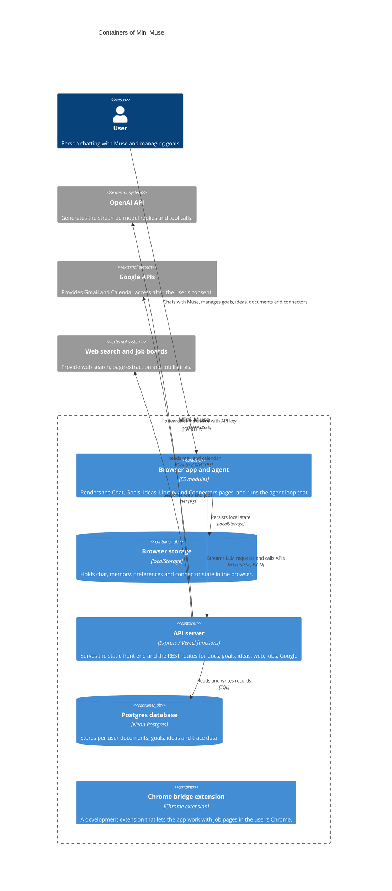

# Containers — Mini Muse

Repository: https://github.com/lngsa1234/mini-muse-mvp · Mapped: 2026-11-18 · Mapped by Alex from the code (C4 model)

C4 level 2: the deployable parts and data stores, and how they talk. The surrounding people and systems are in [System context](c4-context.md); how requests flow step by step is in [Workflows](workflows/README.md).

Mini Muse is a no-build browser app whose chat agent loop runs client-side. A Node/Express server (or Vercel functions) provides the REST APIs and an LLM proxy. A chat turn goes from the browser to the proxy, which adds the API key and streams OpenAI's reply back. The browser then runs tools locally, and those tools call the server APIs for goals, ideas, documents, web search, jobs and Google. The server reads and writes Postgres.

## Containers

| Container | Layer | Technology | What it does | Code |
|---|---|---|---|---|
| Browser app and agent | Client | ES modules | Renders the Chat, Goals, Ideas, Library and Connectors pages, and runs the agent loop that streams model replies and executes tools locally with approvals. | `public/js/agent`, `public/js/features`, `public/js/workflow`, `public/js/main.js` |
| Browser storage | Data | localStorage | Holds chat, memory, preferences and connector state in the browser. | `public/js/core/storage.js`, `public/js/core/state.js` |
| API server | Server | Express / Vercel functions | Serves the static front end and the REST routes for docs, goals, ideas, web, jobs, Google and traces, and proxies LLM calls with a server-held key. | `server/index.js`, `server/proxy.js`, `server/google.js`, `api` |
| Postgres database | Data | Neon Postgres | Stores per-user documents, goals, ideas and trace data. | `server/db.js`, `db/schema.sql` |
| OpenAI API | External services | Chat Completions | Generates the streamed model replies and tool calls. |  |
| Google APIs | External services | OAuth 2.0, Gmail, Calendar | Provides Gmail and Calendar access after the user's consent. |  |
| Web search and job boards | External services | Tavily, Greenhouse/Lever/Ashby | Provide web search, page extraction and job listings. |  |
| Chrome bridge extension | Client | Chrome extension | A development extension that lets the app work with job pages in the user's Chrome. | `chrome-extension` |

## Relationships

- Browser app and agent → Browser storage: Persists local state (localStorage)
- Browser app and agent → API server: Streams LLM requests and calls APIs (HTTPS/SSE, JSON)
- API server → OpenAI API: Forwards completions with API key (HTTPS/SSE)
- API server → Postgres database: Reads and writes records (SQL)
- API server → Google APIs: Reads mail and calendar (OAuth 2.0/HTTPS)
- API server → Web search and job boards: Searches web and jobs (HTTPS)

## Not confirmed

- I did not read server/google.js, web.js, jobs.js or the chrome-extension code, so the Tavily and job board details come from comments and docs.
- The browser app's link to the Chrome extension is not shown because I did not confirm the mechanism.
- The README says goals and ideas use localStorage, but the server wires them to Neon. I followed the server code.
- I did not read server/db.js, so the trace tables in Postgres are unconfirmed.
