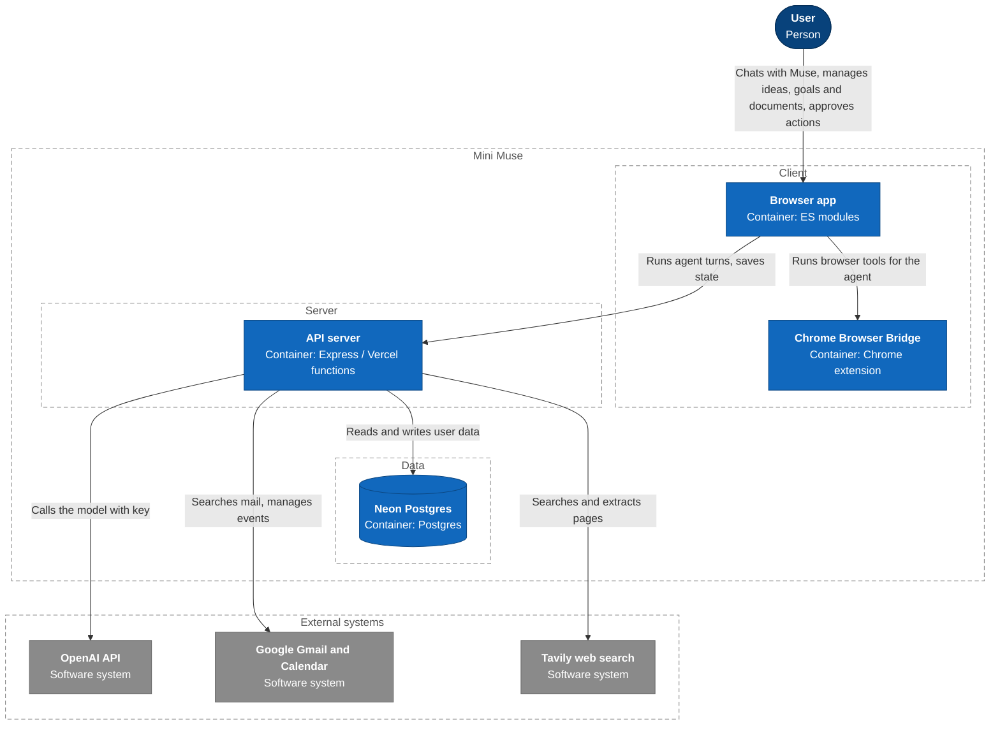

# Containers — Mini Muse

Repository: https://github.com/lngsa1234/mini-muse-mvp · Mapped: 2026-11-22 · Mapped by Alex from the code (C4 model)

C4 level 2: the deployable parts and data stores, how they talk, and the people and outside systems around them. The inside of the browser app, and how each feature works with the agent, is in [Components](c4-components-api-server.md). How requests flow step by step is in [Workflows](workflows/README.md).

Mini Muse is a no-build browser app with a Node/Express (or Vercel function) backend. The agent runs on the server: it builds the prompt from the user’s saved data, calls OpenAI, runs the tools, waits for approvals and streams progress to the page. All user data lives in Neon Postgres, so every device shows the same chat, memory and settings. An optional Chrome extension lets the agent fill in job application forms through the open tab.

## People

- **User** — Person using Muse as a personal agent: chats with Muse, manages ideas, goals and documents, approves actions

## External systems

- **OpenAI API** (Chat Completions): Model that answers agent turns, selected by tier.
- **Google Gmail and Calendar** (Google OAuth 2.0): The user’s Gmail inbox and primary calendar, reached with a token kept in an encrypted HttpOnly cookie.
- **Tavily web search** (Tavily API): Web search and page extraction used by web_search and web_open.

## Containers

| Container | Layer | Technology | What it does | Code |
|---|---|---|---|---|
| Browser app | Client | ES modules | Pages for chat, ideas, goals, library, connectors and settings. Sends each message to the agent on the server, shows its streamed progress and approval cards, and runs browser tools for it. | `public/index.html`, `public/js/main.js`, `public/js/agent`, `public/js/features` |
| Chrome Browser Bridge | Client | Chrome extension | Optional extension that opens, reads, fills and clicks in a job application tab when the page asks. | `chrome-extension/background.js`, `chrome-extension/muse-bridge.js`, `chrome-extension/target.js`, `chrome-extension/manifest.json` |
| API server | Server | Express / Vercel functions | Runs the agent (turns, tools, approvals) and serves the handlers for user state, docs, ideas, goals, web and job search, Google OAuth, Gmail and Calendar, and traces. | `server/index.js`, `server/agent`, `api/agent.js`, `server/google.js`, `api` |
| Neon Postgres | Data | Postgres | Stores everything per user: chat, memory, settings, contacts and the activity log, plus documents, ideas, goals, pending approvals and traces. | `db/schema.sql`, `server/db.js`, `server/userdata.js` |
| OpenAI API | External services | Chat Completions | Model that answers agent turns, selected by tier. |  |
| Google Gmail and Calendar | External services | Google OAuth 2.0 | The user’s Gmail inbox and primary calendar, reached with a token kept in an encrypted HttpOnly cookie. |  |
| Tavily web search | External services | Tavily API | Web search and page extraction used by web_search and web_open. |  |

## Relationships

- Browser app → API server: Runs agent turns, saves state (HTTPS/SSE /api/agent, /api/state)
- API server → OpenAI API: Calls the model with key (HTTPS/SSE)
- API server → Neon Postgres: Reads and writes user data (SQL)
- API server → Google Gmail and Calendar: Searches mail, manages events (OAuth 2.0/HTTPS)
- API server → Tavily web search: Searches and extracts pages (HTTPS)
- Browser app → Chrome Browser Bridge: Runs browser tools for the agent (window.postMessage)

## Not confirmed

- Mapped by hand from the server-runtime change (ADR-0008, ADR-0009), not by a full Alex run; every cited path is checked against the repository.
- Tracing components (server/trace-node.js, server/trace-store.js) are left out of the component view.

