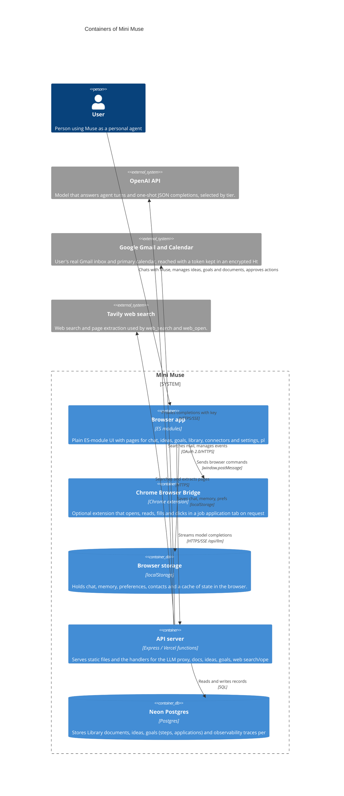

# Containers — Mini Muse

Repository: https://github.com/lngsa1234/mini-muse-mvp · Mapped: 2026-11-18 · Mapped by Alex from the code (C4 model)

C4 level 2: the deployable parts and data stores, and how they talk. The surrounding people and systems are in [System context](c4-context.md); the inside of the browser app, and how each feature works with the agent, is in [Components](c4-components-browser-app.md); how requests flow step by step is in [Workflows](workflows/README.md).

Mini Muse is a no-build browser app with a small Node/Express (or Vercel function) backend. The tool-use agent loop runs in the browser. It streams model calls through a server proxy to OpenAI and runs feature tools locally. Those tools call the backend for Neon Postgres storage (documents, ideas, goals, traces), Gmail and Calendar through Google OAuth, and Tavily and job-board search. An optional Chrome extension lets the agent fill in job application forms.

## Containers

| Container | Layer | Technology | What it does | Code |
|---|---|---|---|---|
| Browser app | Client | ES modules | Plain ES-module UI with pages for chat, ideas, goals, library, connectors and settings, plus the in-browser agent loop, tools and approvals. | `public/index.html`, `public/js/main.js`, `public/js/agent`, `public/js/features` |
| Chrome Browser Bridge | Client | Chrome extension | Optional extension that opens, reads, fills and clicks in a job application tab on request of the page. | `chrome-extension/background.js`, `chrome-extension/muse-bridge.js`, `chrome-extension/target.js`, `chrome-extension/manifest.json` |
| Browser storage | Data | localStorage | Holds chat, memory, preferences, contacts and a cache of state in the browser. | `public/js/core/storage.js`, `public/js/core/state.js` |
| API server | Server | Express / Vercel functions | Serves static files and the handlers for the LLM proxy, docs, ideas, goals, web search/open, job search, Google OAuth/Gmail/Calendar and traces, shared between Express and Vercel functions. | `server/index.js`, `server/proxy.js`, `server/google.js`, `api` |
| Neon Postgres | Data | Postgres | Stores Library documents, ideas, goals (steps, applications) and observability traces per user. | `db/schema.sql`, `server/db.js` |
| OpenAI API | External services | Chat Completions | Model that answers agent turns and one-shot JSON completions, selected by tier. |  |
| Google Gmail and Calendar | External services | Google OAuth 2.0 | User's real Gmail inbox and primary calendar, reached with a token kept in an encrypted HttpOnly cookie. |  |
| Tavily web search | External services | Tavily API | Web search and page extraction used by web_search and web_open. |  |

## Relationships

- Browser app → API server: Streams model completions (HTTPS/SSE /api/llm)
- API server → OpenAI API: Proxies completions with key (HTTPS/SSE)
- API server → Neon Postgres: Reads and writes records (SQL)
- Browser app → Browser storage: Saves chat, memory, prefs (localStorage)
- API server → Google Gmail and Calendar: Searches mail, manages events (OAuth 2.0/HTTPS)
- API server → Tavily web search: Searches and extracts pages (HTTPS)
- Browser app → Chrome Browser Bridge: Sends browser commands (window.postMessage)

## Not confirmed

- Did not read agent/loop.js, tools.js, approvals.js or core/api.js in full; the approval and transport flow is inferred from the architecture doc and tool code.
- Did not read server/db.js, trace code or the Chrome extension source, and did not confirm the memory, web_search, web_open, jobs_search or score_fit tool definitions.
- Contacts tools names and approval behavior were not confirmed beyond the file header.
- Job-board APIs (Greenhouse, Lever, Ashby) were not shown as a component; the server reaches them through its job search handler.
- Not all tool needsApproval flags were verified in the agent policy code, and docs_add has no approval in the code I read.
