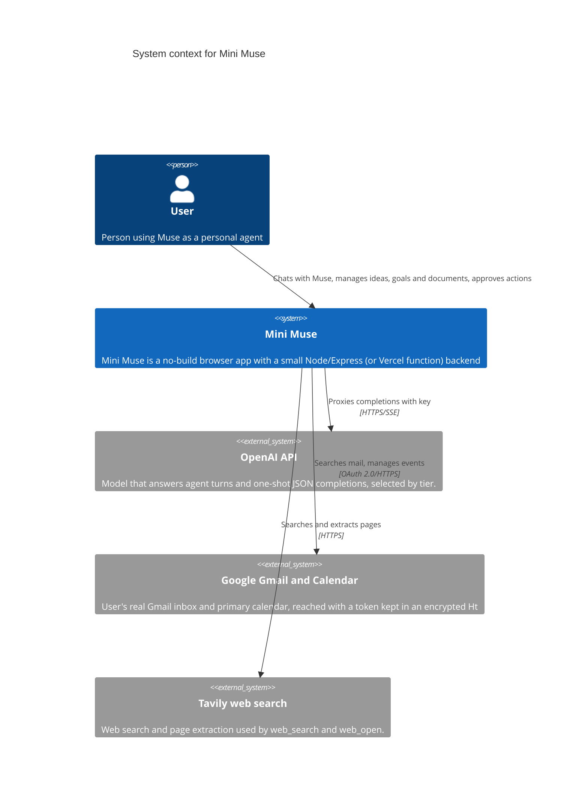

# System context — Mini Muse

Repository: https://github.com/lngsa1234/mini-muse-mvp · Mapped: 2026-11-18 · Mapped by Alex from the code (C4 model)

C4 level 1: who uses the system and which outside systems it depends on. The parts inside it are in [Containers](c4-containers.md).

## People

- **User** — Person using Muse as a personal agent chats with Muse, manages ideas, goals and documents, approves actions.

## External systems

- **OpenAI API** (Chat Completions): Model that answers agent turns and one-shot JSON completions, selected by tier.
- **Google Gmail and Calendar** (Google OAuth 2.0): User's real Gmail inbox and primary calendar, reached with a token kept in an encrypted HttpOnly cookie.
- **Tavily web search** (Tavily API): Web search and page extraction used by web_search and web_open.
