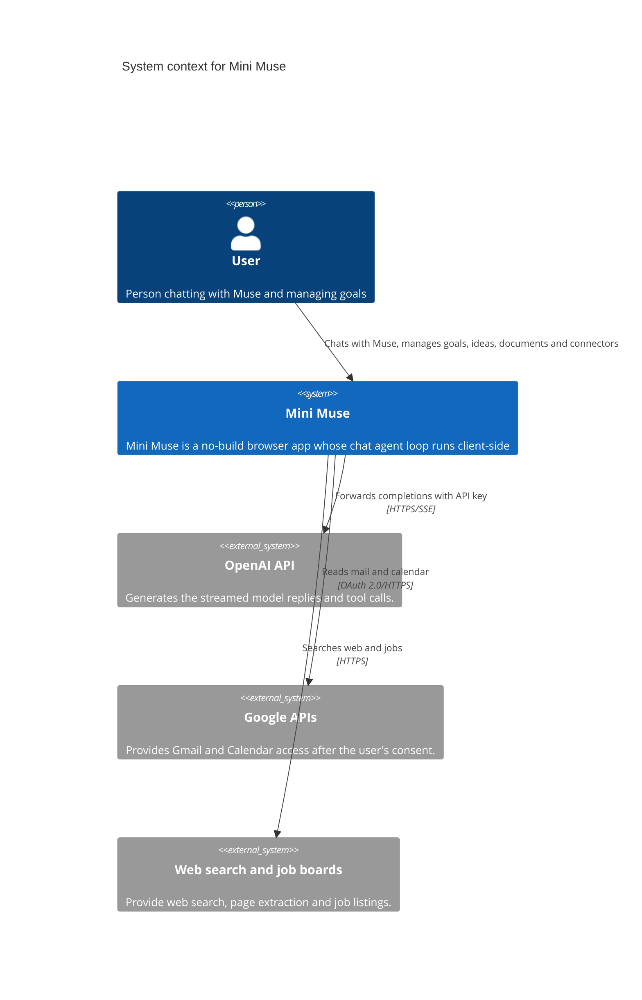

# System context — Mini Muse

Repository: https://github.com/lngsa1234/mini-muse-mvp · Mapped: 2026-11-18 · Mapped by Alex from the code (C4 model)

C4 level 1: who uses the system and which outside systems it depends on. The parts inside it are in [Containers](c4-containers.md).

## People

- **User** — Person chatting with Muse and managing goals chats with Muse, manages goals, ideas, documents and connectors.

## External systems

- **OpenAI API** (Chat Completions): Generates the streamed model replies and tool calls.
- **Google APIs** (OAuth 2.0, Gmail, Calendar): Provides Gmail and Calendar access after the user's consent.
- **Web search and job boards** (Tavily, Greenhouse/Lever/Ashby): Provide web search, page extraction and job listings.
