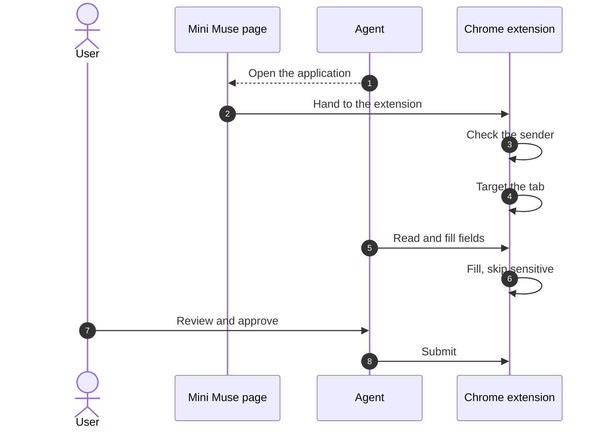

# How Muse fills an application in Chrome

Mapped: 2026-11-21 · Mapped by Alex from the code

Muse fills in a job application in the user’s own Chrome tab through the optional extension, and only submits it after the user has reviewed it and approved.

**Starts when:** The user asks Muse to fill in a specific application they chose

## Steps

| # | Who | What happens | Hands to | Code |
|---|---|---|---|---|
| 1 | Agent | Asks the page to open the application URL in a new Chrome tab | Client: `browser_open(url)` | `public/js/features/browser/browser.js:22` |
| 2 | Client | Posts the request to the extension through a window message, checking the reply comes from the same origin | External: `postMessage(source: mini-muse)` | `public/js/features/browser/browser.js:6-16` |
| 3 | External | Relays the request to the extension’s background script, which only accepts messages from the Mini Muse origins |  | `chrome-extension/muse-bridge.js`, `chrome-extension/background.js:9-14` |
| 4 | External | Picks the last non–Mini Muse tab, checks the user allowed control of that site, and injects the form script |  | `chrome-extension/background.js:16-28` |
| 5 | Agent | Reads the form fields, then fills the ones the Library résumé supports | External: `browser_fields, browser_fill(fields)` | `public/js/features/browser/browser.js:24-32` |
| 6 | External | Fills the fields in the tab and skips passwords, SSNs and card or account numbers |  | `chrome-extension/target.js:8`, `chrome-extension/target.js:54` |
| 7 | User | Reviews the filled form in Chrome and approves the Submit click on the approval card | Agent: `Submit it` |  |
| 8 | Agent | Clicks Submit in the tab | External: `browser_click(selector)` | `public/js/features/browser/browser.js:33-40` |

## When it goes wrong

- Without the extension, a request times out after 12 seconds and Muse is told to use web_open or ask the user to install it.
- If the user hasn’t allowed control of the site, the extension refuses and asks them to allow it in the extension popup.
- If the extension was reloaded, the page is asked to reload to reconnect.
- If the user doesn’t approve the click, nothing is clicked and the refusal goes back to Muse.

## Features it serves

- [Browser bridge](../../specs/browser-bridge.md)
- [Library](../../specs/library.md)
- [Approvals](../../specs/tool-approvals.md)

