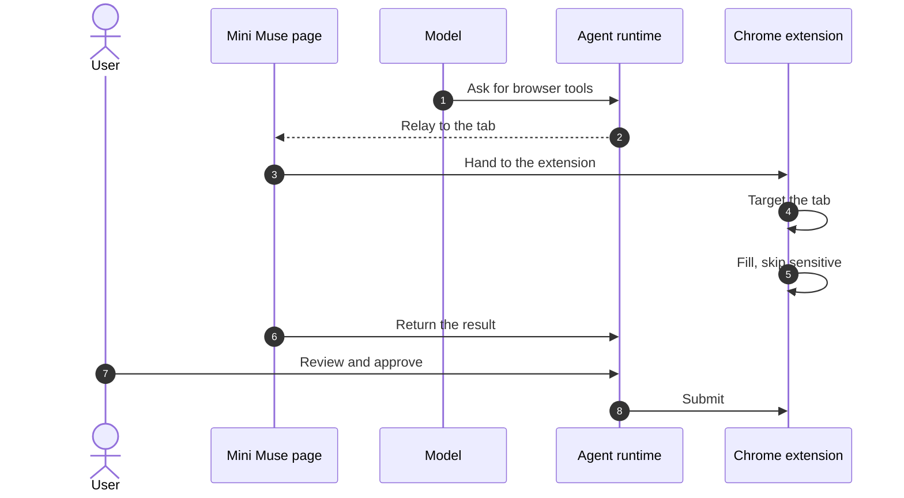

# How Muse fills an application in Chrome

Mapped: 2026-11-22 · Mapped by Alex from the code

Muse fills in a job application in the user’s own Chrome tab: the agent runtime on the server asks the Mini Muse tab that started the turn to run each browser tool through the extension, and only submits after the user approves.

**Starts when:** The user asks Muse to fill in a specific application they chose

## Steps

| # | From → To | What happens | Code |
|---|---|---|---|
| 1 | Model → Agent runtime | Asks to open the application, read its fields and fill them from the Library résumé · `browser_open, browser_fields, browser_fill` | [tools/browser.js:14-23](../../../server/agent/tools/browser.js#L14-L23) |
| 2 | Agent runtime → Mini Muse page | Creates a wait record and sends the tool to the tab that started the turn · `SSE client_tool` | [runtime.js:198-200](../../../server/agent/runtime.js#L198-L200) |
| 3 | Mini Muse page → Chrome extension | Passes the request to the extension by window message, checking the reply comes from the same origin · `postMessage` | [run.js:79](../../../public/js/agent/run.js#L79), [browser/browser.js:28](../../../public/js/features/browser/browser.js#L28) |
| 4 | Chrome extension | Accepts only messages from the Mini Muse origins, picks the last non–Mini Muse tab, checks site permission and injects the form script | [background.js:9-14](../../../chrome-extension/background.js#L9-L14), [background.js:16-28](../../../chrome-extension/background.js#L16-L28) |
| 5 | Chrome extension | Reads or fills the fields in the tab, skipping passwords, SSNs and card or account numbers | [target.js:8](../../../chrome-extension/target.js#L8), [target.js:54](../../../chrome-extension/target.js#L54) |
| 6 | Mini Muse page → Agent runtime | Posts the tool’s result back so the waiting turn continues · `POST /api/agent/answer` | [run.js](../../../public/js/agent/run.js) |
| 7 | User → Agent runtime | ✋ Reviews the filled form in Chrome and approves the Submit click on the approval card · `Submit it` |  |
| 8 | Agent runtime → Chrome extension | Relays the Submit click to the tab the same way · `browser_click` | [tools/browser.js:30-36](../../../server/agent/tools/browser.js#L30-L36) |

✋ The step waits for the user.

## When it goes wrong

- If the tab that started the turn doesn’t answer within 45 seconds (it may be closed), the tool fails and Muse is told not to retry browser tools this turn.
- Without the extension, the page’s request times out after 12 seconds with a message to use web_open or install it.
- If the user hasn’t allowed control of the site, the extension refuses and asks them to allow it in its popup.
- If the user doesn’t approve the click, nothing is clicked and the refusal goes back to Muse.

## Features it serves

- [Browser bridge](../../specs/browser-bridge.md)
- [Library](../../specs/library.md)
- [Approvals](../../specs/tool-approvals.md)

