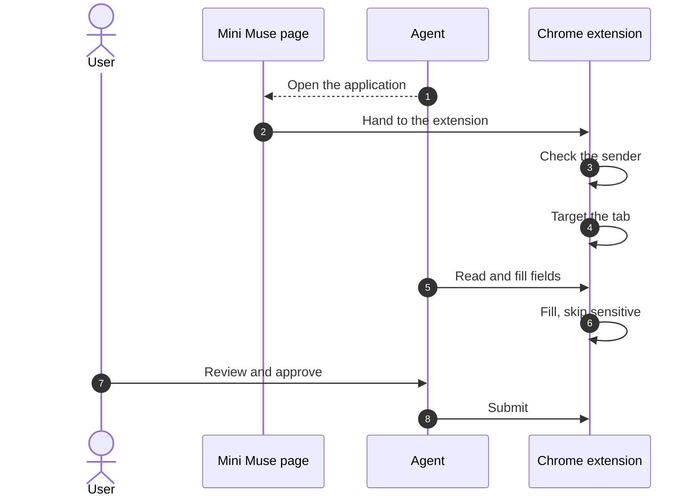

# How Muse fills an application in Chrome

Mapped: 2026-11-22 · Mapped by Alex from the code

Muse fills in a job application in the user’s own Chrome tab through the optional extension, and only submits it after the user has reviewed it and approved.

**Starts when:** The user asks Muse to fill in a specific application they chose

## Steps

| # | From → To | What happens | Code |
|---|---|---|---|
| 1 | Agent → Mini Muse page | Asks the page to open the application URL in a new Chrome tab · `browser_open(url)` | [browser.js:22](../../../public/js/features/browser/browser.js#L22) |
| 2 | Mini Muse page → Chrome extension | Posts the request to the extension through a window message, checking the reply comes from the same origin · `postMessage(source: mini-muse)` | [browser.js:6-16](../../../public/js/features/browser/browser.js#L6-L16) |
| 3 | Chrome extension | Relays the request to the extension’s background script, which only accepts messages from the Mini Muse origins | [muse-bridge.js](../../../chrome-extension/muse-bridge.js), [background.js:9-14](../../../chrome-extension/background.js#L9-L14) |
| 4 | Chrome extension | Picks the last non–Mini Muse tab, checks the user allowed control of that site, and injects the form script | [background.js:16-28](../../../chrome-extension/background.js#L16-L28) |
| 5 | Agent → Chrome extension | Reads the form fields, then fills the ones the Library résumé supports · `browser_fields, browser_fill(fields)` | [browser.js:24-32](../../../public/js/features/browser/browser.js#L24-L32) |
| 6 | Chrome extension | Fills the fields in the tab and skips passwords, SSNs and card or account numbers | [target.js:8](../../../chrome-extension/target.js#L8), [target.js:54](../../../chrome-extension/target.js#L54) |
| 7 | User → Agent | ✋ Reviews the filled form in Chrome and approves the Submit click on the approval card · `Submit it` |  |
| 8 | Agent → Chrome extension | Clicks Submit in the tab · `browser_click(selector)` | [browser.js:33-40](../../../public/js/features/browser/browser.js#L33-L40) |

✋ The step waits for the user.

## When it goes wrong

- Without the extension, a request times out after 12 seconds and Muse is told to use web_open or ask the user to install it.
- If the user hasn’t allowed control of the site, the extension refuses and asks them to allow it in the extension popup.
- If the extension was reloaded, the page is asked to reload to reconnect.
- If the user doesn’t approve the click, nothing is clicked and the refusal goes back to Muse.

## Features it serves

- [Browser bridge](../../specs/browser-bridge.md)
- [Library](../../specs/library.md)
- [Approvals](../../specs/tool-approvals.md)

