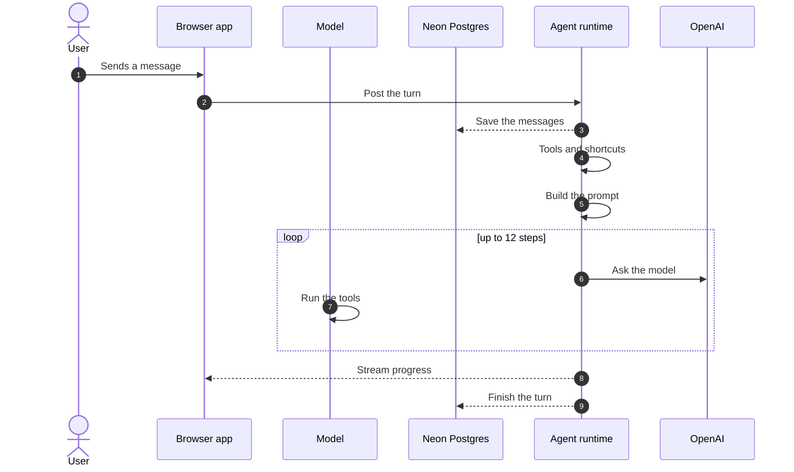

# How a chat turn runs

Mapped: 2026-11-22 · Mapped by Alex from the code

A message goes to the agent runtime on the server, which saves it, builds the prompt from the user’s saved data, calls the model and runs the tools it asks for, and streams progress back to the page. The turn keeps going if the tab closes.

**Starts when:** The user presses Send in chat, or another page sends a message such as New goal, Do it or Ask Muse to move this forward

## Steps

| # | From → To | What happens | Code |
|---|---|---|---|
| 1 | User → Browser app | Submits a message from the composer or a feature button |  |
| 2 | Browser app → Agent runtime | Shows the message, disables the composer and posts it with the response tier and time zone · `POST /api/agent/turn` | [run.js](../../../public/js/agent/run.js) |
| 3 | Agent runtime → Neon Postgres | Refuses if another turn for this user is still live, then saves the user message and a live reply · `chat_messages` | [runtime.js:158-171](../../../server/agent/runtime.js#L158-L171), [userdata.js](../../../server/userdata.js) |
| 4 | Agent runtime | Builds the tools and runs the shortcuts: Library check for résumé steps, a job-research nudge, opening an application link | [runtime.js:268-282](../../../server/agent/runtime.js#L268-L282), [tools/index.js](../../../server/agent/tools/index.js) |
| 5 | Agent runtime | Builds the system prompt from saved memory, ideas, goals and settings, plus the last 18 messages | [prompt.js](../../../server/agent/prompt.js) |
| 6 | Agent runtime → OpenAI | _Repeats, up to 12 steps (steps 6–7):_ Streams a model turn with the server-held key and a model picked from the tier · `POST chat completions` | [llm.js](../../../server/agent/llm.js), [routing.js](../../../server/routing.js) |
| 7 | Model | Asks for tools; the runtime runs each one, logs it and feeds the result back | [loop.js:17](../../../server/agent/loop.js#L17), [tools/index.js](../../../server/agent/tools/index.js) |
| 8 | Agent runtime → Browser app | Streams events to the page and saves the reply every few seconds · `SSE text, audit, done` | [http.js](../../../server/agent/http.js) |
| 9 | Agent runtime → Neon Postgres | Ends the turn: expires unanswered approvals, marks the reply finished and saves it · `chat_messages` | [runtime.js](../../../server/agent/runtime.js) |

## When it goes wrong

- No API key: the turn ends with sampling_disabled; the page shows the assistant-unavailable message and disables the composer.
- Model errors 401, 403, 429 and 400 map to session_expired, not_granted, rate_limited, prompt_too_large or refused.
- A tool that throws, or an unknown tool, goes back to the model as an error result instead of ending the turn.
- Stop, from any device, cancels the turn through /api/agent/cancel; no error is shown.
- If the page’s stream drops, the turn keeps running; the page polls /api/state until the reply is finished.
- If another turn is live, the server answers busy and the page puts the text back in the composer.

## Features it serves

- [Agent chat](../../specs/agent-chat.md)
- [Observability](../../specs/observability.md)

