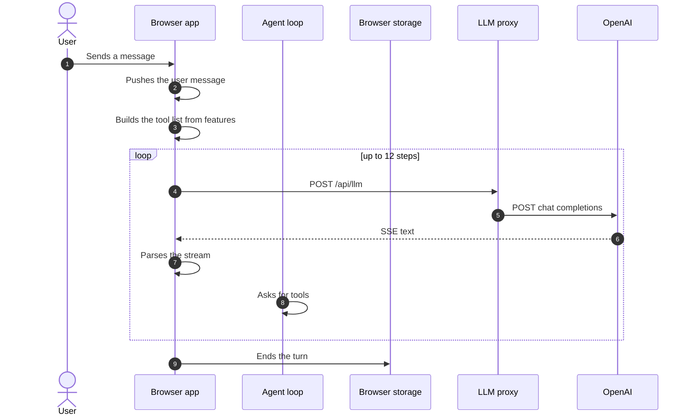

# How a chat turn runs

Mapped: 2026-11-22 · Mapped by Alex from the code

A user message goes to the browser agent loop. The loop streams model replies through the server proxy, runs the tools the model asks for locally, and repeats until the model gives a final answer.

**Starts when:** The user presses Send in chat, or another page sends a message such as New goal, Do it or Ask Muse to move this forward.

## Steps

| # | From → To | What happens | Code |
|---|---|---|---|
| 1 | User → Browser app | Submits a message from the composer or from a feature button · `run(userMsg)` |  |
| 2 | Browser app | Pushes the user message and a live assistant placeholder, disables the composer, shows Stop, and starts a trace for the turn | [run.js](../../../public/js/agent/run.js) |
| 3 | Browser app | Builds the tool list from features and connected connectors, then applies pre-model shortcuts: Library check for résumé steps, a job-research nudge, and opening an application link in Chrome | [run.js](../../../public/js/agent/run.js), [tools.js](../../../public/js/agent/tools.js) |
| 4 | Browser app → LLM proxy | _Repeats, up to 12 steps (steps 4–8):_ Sends the conversation and tool definitions with a trace header. It sends a tier and never a model name · `POST /api/llm (…)` | [loop.js](../../../public/js/agent/loop.js), [transport.js](../../../public/js/agent/transport.js) |
| 5 | LLM proxy → OpenAI | Drops any client model, maps the tier to a model, adds the API key and forwards the request to OpenAI · `POST chat completions (…)` | [proxy.js](../../../server/proxy.js), [routing.js](../../../server/routing.js), [llm.js](../../../api/llm.js) |
| 6 | OpenAI → Browser app | Streams the reply back through the proxy · `SSE text and tool_call deltas` |  |
| 7 | Browser app | Parses the stream and updates the message text live | [transport.js](../../../public/js/agent/transport.js), [chat.js](../../../public/js/features/chat/chat.js) |
| 8 | Agent loop | Asks for tools. The loop runs each one locally and feeds the result back as a tool message. It repeats up to 12 steps until the model stops asking for tools | [loop.js](../../../public/js/agent/loop.js), [tools.js](../../../public/js/agent/tools.js) |
| 9 | Browser app → Browser storage | Ends the turn: expires unanswered approvals, marks the message not live, shows a truncation notice if the reply hit the token limit, and saves state in browser storage · `save() chat state` | [run.js](../../../public/js/agent/run.js), [storage.js](../../../public/js/core/storage.js) |

## When it goes wrong

- If the server has no API key it returns 503 no_api_key. The client maps this to sampling_disabled, shows the assistant-unavailable message and disables the composer.
- HTTP 401, 403 and 429 map to session_expired, not_granted and rate_limited messages. A 400 maps to prompt_too_large or refused.
- If the server cannot be reached the turn fails with a generic 'send your message again' message. If OpenAI is unreachable the proxy has an upstream_unreachable 502 response.
- A tool that throws, or an unknown tool, goes back to the model as an 'Error: …' tool result instead of ending the turn.
- If the user presses Stop the turn is cancelled and no error is shown. If the reply ends at max tokens, 'The reply was cut short' is shown.
- If opening or reading the application page fails, or job tools are off, the shortcut replies without calling the model.

## Features it serves

- [Agent chat](../../specs/agent-chat.md)
- [Observability](../../specs/observability.md)

