# How a chat turn runs

Repository: https://github.com/lngsa1234/mini-muse-mvp · Mapped: 2026-11-18 · Mapped by Alex from the code

A user message goes through a few built-in shortcuts, then through a model-and-tools loop that runs in the browser. The model's reply streams back into the chat.

**Starts when:** The user submits a message in the chat composer. Buttons on other pages, such as Do it or Ask Muse to move this forward, send a message the same way.

```mermaid
flowchart TB
  start(["The user submits a message in the chat composer. Buttons on other pages, such as Do it or Ask Muse to move this forward, send a message the same way."])
  s1["1. User<br/>Types a message and presses Enter or Send."]
  s2["2. Client<br/>Adds the user message and a live assistant placeholder to the chat, starts a trace for the turn, and builds the tool list from the features and the connected connectors."]
  s3["3. Client<br/>Runs shortcuts before calling the model. These are Library verification of document goal steps, a job-research nudge, and opening an application link in Chrome. If a shortcut already settles the turn,"]
  s4["4. Client<br/>Builds the prompt and conversation. The loop moves the instructions into a system message and sends the conversation and tool definitions with the chosen tier. Gmail tools are withheld when the user a"]
  s5["5. Server<br/>The LLM proxy checks that an API key is set, removes any client-sent model, picks the model from the tier, and forwards the request to OpenAI. With no key it returns 503 no_api_key."]
  s6["6. External<br/>OpenAI streams back text and tool-call events."]
  s7["7. Client<br/>Reads the event stream and shows the growing reply in the message. It collects the tool calls and the finish reason."]
  s8["8. Client<br/>If the model asked for tools, runs each one locally and appends the results as tool messages. Unknown tools and tool errors go back to the model as Error text. This repeats for at most 12 steps."]
  s9["9. Client<br/>Finishes the turn. It flags a reply that hit the token limit, maps errors to user-facing messages, expires pending approvals, saves state and flushes the trace."]
  start --> s1
  s1 --> s2
  s2 --> s3
  s3 --> s4
  s4 --> s5
  s5 --> s6
  s6 --> s7
  s7 --> s8
  s8 --> s9
  classDef user fill:#F1EFE8,stroke:#5F5E5A,color:#2C2C2A
  classDef agent fill:#EEEDFE,stroke:#534AB7,color:#26215C
  classDef client fill:#E1F5FE,stroke:#0E7490,color:#164E63
  classDef server fill:#E1F5EE,stroke:#0F6E56,color:#04342C
  classDef data fill:#F3E8FF,stroke:#7E22CE,color:#3B0764
  classDef external fill:#FAEEDA,stroke:#854F0B,color:#412402
  class s1 user
  class s2 client
  class s3 client
  class s4 client
  class s5 server
  class s6 external
  class s7 client
  class s8 client
  class s9 client
```

## Steps

| # | Who | What happens | Code |
|---|---|---|---|
| 1 | User | Types a message and presses Enter or Send. |  |
| 2 | Client | Adds the user message and a live assistant placeholder to the chat, starts a trace for the turn, and builds the tool list from the features and the connected connectors. | `public/js/agent/run.js`, `public/js/agent/tools.js` |
| 3 | Client | Runs shortcuts before calling the model. These are Library verification of document goal steps, a job-research nudge, and opening an application link in Chrome. If a shortcut already settles the turn, | `public/js/agent/run.js`, `public/js/agent/intent.js` |
| 4 | Client | Builds the prompt and conversation. The loop moves the instructions into a system message and sends the conversation and tool definitions with the chosen tier. Gmail tools are withheld when the user a | `public/js/agent/prompt.js`, `public/js/agent/loop.js` |
| 5 | Server | The LLM proxy checks that an API key is set, removes any client-sent model, picks the model from the tier, and forwards the request to OpenAI. With no key it returns 503 no_api_key. | `server/proxy.js`, `server/routing.js` |
| 6 | External | OpenAI streams back text and tool-call events. |  |
| 7 | Client | Reads the event stream and shows the growing reply in the message. It collects the tool calls and the finish reason. | `public/js/agent/transport.js` |
| 8 | Client | If the model asked for tools, runs each one locally and appends the results as tool messages. Unknown tools and tool errors go back to the model as Error text. This repeats for at most 12 steps. | `public/js/agent/loop.js`, `public/js/agent/tools.js` |
| 9 | Client | Finishes the turn. It flags a reply that hit the token limit, maps errors to user-facing messages, expires pending approvals, saves state and flushes the trace. | `public/js/agent/run.js` |

## Use cases it carries out

- [goals/UC-1](../../use-cases/goals/uc-1-capture-a-goal-and-have-muse-plan-it.md)
