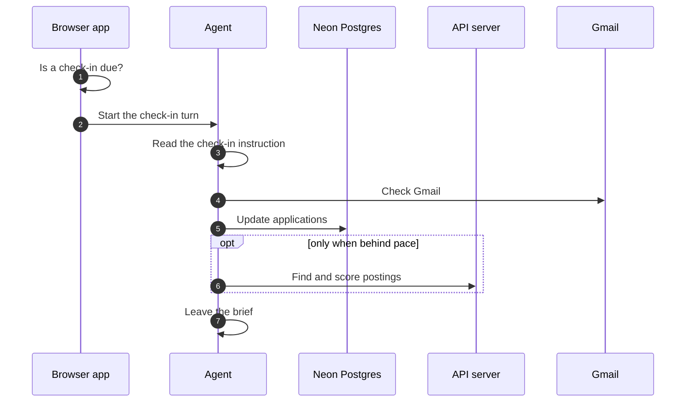

# How the daily check-in runs

Mapped: 2026-11-22 · Mapped by Alex from the code

Once a day, or when the user clicks the button, Muse works on the user’s goals without being asked and leaves a short progress brief in chat. It only runs while the app is open.

**Starts when:** The app is open after 9am with Every day on and no check-in yet today, or the user clicks the check-in button

## Steps

| # | From → To | What happens | Code |
|---|---|---|---|
| 1 | Browser app | Checks every five minutes, and 20 seconds after the app opens, whether a check-in is due: Every day is on, none ran today, it is after 9am, Muse is free and there is a goal | [checkin.js:27-33](../../../public/js/workflow/checkin.js#L27-L33) |
| 2 | Browser app → Agent | Records today as the last check-in and starts a turn with a check-in message instead of a user message · `run(role: checkin)` | [checkin.js:21-24](../../../public/js/workflow/checkin.js#L21-L24) |
| 3 | Agent | Gets the fixed check-in instruction: the user is away, do what can be done alone, do not send emails, never submit an application | [prompt.js:54](../../../public/js/agent/prompt.js#L54), [checkin.js:14-16](../../../public/js/workflow/checkin.js#L14-L16) |
| 4 | Agent → Gmail | Searches Gmail for application confirmations and employer replies · `mail_search via /api/google/mail` | [checkin.js:15](../../../public/js/workflow/checkin.js#L15) |
| 5 | Agent → Neon Postgres | Updates tracked applications and works out pace against the target and deadline · `track_application` | [goals.js](../../../public/js/features/goals/goals.js) |
| 6 | Agent → API server | _Only when behind pace:_ When behind pace, searches the watched companies’ hiring pages and scores new postings against the résumé · `jobs_search, score_fit` | [jobs.js](../../../public/js/features/jobs/jobs.js) |
| 7 | Agent | Writes a three-line progress brief and what needs the user’s decision into chat | [checkin.js:16](../../../public/js/workflow/checkin.js#L16), [run.js](../../../public/js/agent/run.js) |

## When it goes wrong

- If the app is closed, nothing runs: there is no server-side scheduler, so the check-in waits until the app is next open after 9am.
- If Muse is busy, the assistant is unavailable or there are no goals, the check-in is skipped and tried again five minutes later.
- "Do not send emails" is an instruction to the model, not a tool restriction: mail_send is still offered, and its approval card is what stops an email being sent while the user is away.

## Features it serves

- [Daily check-in](../../specs/daily-check-in.md)
- [Goals](../../specs/goals.md)
- [Connectors](../../specs/connectors.md)

