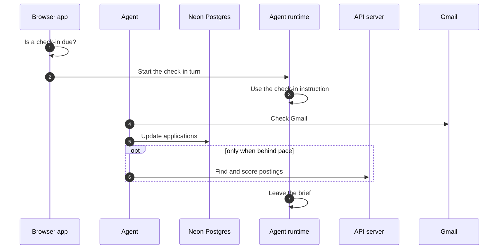

# How the daily check-in runs

Mapped: 2026-11-22 · Mapped by Alex from the code

Once a day, or when the user clicks the button, the open app starts a turn in which Muse works on the user’s goals without being asked and leaves a short progress brief. The turn runs on the server, but only an open app can start it.

**Starts when:** The app is open after 9am with Every day on and no check-in yet today, or the user clicks the check-in button

## Steps

| # | From → To | What happens | Code |
|---|---|---|---|
| 1 | Browser app | Checks every five minutes, and 20 seconds after the app opens, whether a check-in is due: Every day is on, none ran today, it is after 9am, Muse is free and there is a goal | [checkin.js:27-33](../../../public/js/workflow/checkin.js#L27-L33) |
| 2 | Browser app → Agent runtime | Records today as the last check-in and starts a check-in turn on the server · `POST /api/agent/turn (checkin)` | [checkin.js:19-22](../../../public/js/workflow/checkin.js#L19-L22), [run.js](../../../public/js/agent/run.js) |
| 3 | Agent runtime | Uses the fixed check-in instruction: the user is away, do what can be done alone, do not send emails, never submit an application | [prompt.js:9](../../../server/agent/prompt.js#L9), [checkin-prompt.js](../../../public/js/workflow/checkin-prompt.js) |
| 4 | Agent → Gmail | Searches Gmail for application confirmations and employer replies · `mail_search` | [checkin-prompt.js](../../../public/js/workflow/checkin-prompt.js), [connectors.js](../../../server/agent/tools/connectors.js) |
| 5 | Agent → Neon Postgres | Updates tracked applications and works out pace against the target and deadline · `track_application` | [goals.js:87](../../../server/agent/tools/goals.js#L87) |
| 6 | Agent → API server | _Only when behind pace:_ When behind pace, searches the watched companies’ hiring pages and scores new postings against the résumé · `jobs_search, score_fit` | [jobs.js](../../../server/agent/tools/jobs.js) |
| 7 | Agent runtime | Saves the three-line progress brief and what needs the user’s decision; it shows in chat on every device | [runtime.js](../../../server/agent/runtime.js) |

## When it goes wrong

- If the app is closed, nothing starts: there is no server-side scheduler. Once started, the turn finishes even if the tab closes.
- If Muse is busy, the assistant is unavailable or there are no goals, the check-in is skipped and tried again five minutes later.
- "Do not send emails" is an instruction to the model, not a tool restriction: mail_send is still offered, and its approval card is what stops an email being sent while the user is away.

## Features it serves

- [Daily check-in](../../specs/daily-check-in.md)
- [Goals](../../specs/goals.md)
- [Connectors](../../specs/connectors.md)

