# How a goal step advances

Repository: https://github.com/lngsa1234/mini-muse-mvp · Mapped: 2026-11-18 · Mapped by Alex from the code

Muse creates a goal with steps and may mark a step doing or done only when a tool did that step's work in the same turn. Job applications are tracked with the same kind of proof.

**Starts when:** The user adds a goal, or asks Muse to move a goal forward from chat or the Goals page.

```mermaid
flowchart TB
  start(["The user adds a goal, or asks Muse to move a goal forward from chat or the Goals page."])
  s1["1. User<br/>Types a goal on the Goals page or clicks Ask Muse to move this forward. This sends a normal chat message."]
  s2["2. Agent<br/>Calls create_goal with 3 to 6 steps. It can also pass a target metric, count and number of days."]
  s3["3. Server<br/>The goals API validates the input, keeps at most 8 steps and stores the goal for the user."]
  s4["4. Client<br/>If the step is about a résumé and the user asked to move the goal forward, the pre-model shortcut searches the Library. It marks the step done only if a document matches."]
  s5["5. Agent<br/>Runs a tool for a step, such as docs_search, jobs_search or a browser action, then calls update_step with the tool named as evidence."]
  s6["6. Client<br/>update_step refuses doing or done unless a non-bookkeeping tool ran this turn and matches the cited evidence. Résumé steps need a docs_search that found a document."]
  s7["7. Server<br/>Saves the new step status through the goals API. The user can also click a step to mark it done or undo it."]
  s8["8. Agent<br/>Calls track_application for job applications. The client only accepts a status that this turn's actions prove, such as drafted after docs_add. It accepts applied after an approved Submit click or a Gm"]
  start --> s1
  s1 --> s2
  s2 --> s3
  s3 --> s4
  s4 --> s5
  s5 --> s6
  s6 --> s7
  s7 --> s8
  classDef user fill:#F1EFE8,stroke:#5F5E5A,color:#2C2C2A
  classDef agent fill:#EEEDFE,stroke:#534AB7,color:#26215C
  classDef client fill:#E1F5FE,stroke:#0E7490,color:#164E63
  classDef server fill:#E1F5EE,stroke:#0F6E56,color:#04342C
  classDef data fill:#F3E8FF,stroke:#7E22CE,color:#3B0764
  classDef external fill:#FAEEDA,stroke:#854F0B,color:#412402
  class s1 user
  class s2 agent
  class s3 server
  class s4 client
  class s5 agent
  class s6 client
  class s7 server
  class s8 agent
```

## Steps

| # | Who | What happens | Code |
|---|---|---|---|
| 1 | User | Types a goal on the Goals page or clicks Ask Muse to move this forward. This sends a normal chat message. | `public/js/features/goals/goals.js` |
| 2 | Agent | Calls create_goal with 3 to 6 steps. It can also pass a target metric, count and number of days. | `public/js/features/goals/goals.js` |
| 3 | Server | The goals API validates the input, keeps at most 8 steps and stores the goal for the user. | `server/goals.js`, `server/db.js` |
| 4 | Client | If the step is about a résumé and the user asked to move the goal forward, the pre-model shortcut searches the Library. It marks the step done only if a document matches. | `public/js/agent/run.js`, `public/js/features/library/library.js` |
| 5 | Agent | Runs a tool for a step, such as docs_search, jobs_search or a browser action, then calls update_step with the tool named as evidence. | `public/js/features/goals/goals.js` |
| 6 | Client | update_step refuses doing or done unless a non-bookkeeping tool ran this turn and matches the cited evidence. Résumé steps need a docs_search that found a document. | `public/js/features/goals/goals.js` |
| 7 | Server | Saves the new step status through the goals API. The user can also click a step to mark it done or undo it. | `server/goals.js` |
| 8 | Agent | Calls track_application for job applications. The client only accepts a status that this turn's actions prove, such as drafted after docs_add. It accepts applied after an approved Submit click or a Gm | `public/js/features/goals/goals.js` |

## Use cases it carries out

- [goals/UC-1](../../use-cases/goals/uc-1-capture-a-goal-and-have-muse-plan-it.md)
- [goals/UC-2](../../use-cases/goals/uc-2-muse-works-through-goal-steps.md)
- [goals/UC-3](../../use-cases/goals/uc-3-verify-step-progress-with-tool-evidence.md)
- [goals/UC-4](../../use-cases/goals/uc-4-set-a-measurable-target-and-deadline.md)
- [goals/UC-5](../../use-cases/goals/uc-5-track-job-applications-with-proof.md)
