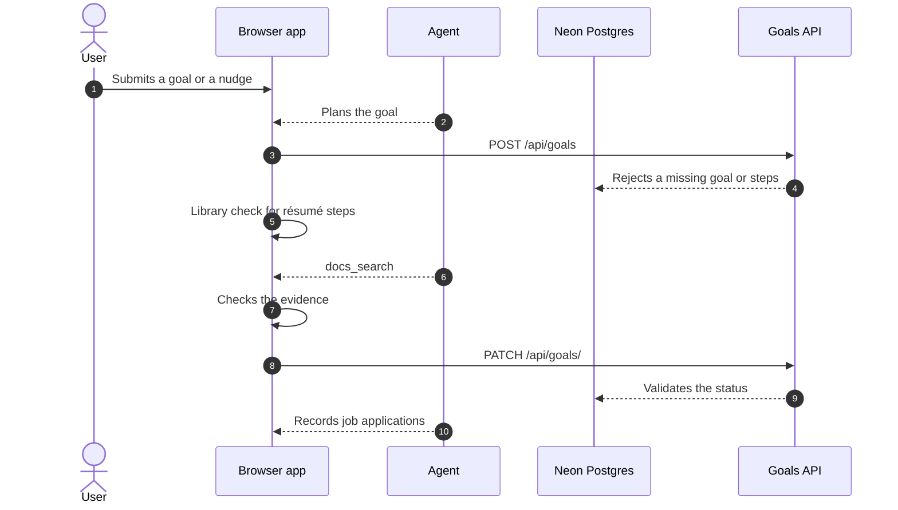

# How a goal step advances

Mapped: 2026-11-22 · Mapped by Alex from the code

Muse creates a goal with a plan and moves a step to doing or done only when a tool did that step's work in the same turn. Application statuses are checked against proof in the same way.

**Starts when:** The user types a goal on the Goals page, or asks Muse to move a goal forward from chat or the Goals page.

## Steps

| # | From → To | What happens | Code |
|---|---|---|---|
| 1 | User → Browser app | Submits a goal or a nudge, which is sent as a normal chat message · `say(…) or say(…)` | [goals/goals.js](../../../public/js/features/goals/goals.js) |
| 2 | Agent → Browser app | Plans the goal with 3 to 6 steps and an optional measurable target and deadline · `create_goal(…)` | [goals/goals.js](../../../public/js/features/goals/goals.js) |
| 3 | Browser app → Goals API | Saves the goal through the goals API · `POST /api/goals` | [api.js](../../../public/js/core/api.js), [goals/index.js](../../../api/goals/index.js) |
| 4 | Goals API → Neon Postgres | Rejects a missing goal or steps and invalid target or deadline with 400. Otherwise stores the goal and returns 201 · `createGoal(…)` | [server/goals.js](../../../server/goals.js), [db.js](../../../server/db.js) |
| 5 | Browser app | For a résumé step the user wants moved forward, the pre-model shortcut searches the Library and marks the step done only if a document matches | [run.js](../../../public/js/agent/run.js) |
| 6 | Agent → Browser app | Runs a real tool for the step, then asks to mark it, naming the tool as evidence · `docs_search, jobs_search or a browser tool, then update_step(…)` | [goals/goals.js](../../../public/js/features/goals/goals.js) |
| 7 | Browser app | Refuses doing or done unless a non-bookkeeping tool ran this turn and matches the cited evidence. Résumé steps need a docs_search that found a document | [goals/goals.js](../../../public/js/features/goals/goals.js) |
| 8 | Browser app → Goals API | Saves the accepted step status. The user can also click a step to mark it done or undo it · `PATCH /api/goals/:id { step, status }` | [api.js](../../../public/js/core/api.js), [goals/[id].js](../../../api/goals/[id].js) |
| 9 | Goals API → Neon Postgres | Validates the status and step number and stores the updated steps · `updateGoal(userId, id, steps)` | [server/goals.js](../../../server/goals.js), [db.js](../../../server/db.js) |
| 10 | Agent → Browser app | Records job applications. The client accepts drafted only after docs_add, and applied only after an approved Submit click or a Gmail confirmation email. Interview, offer and rejected need an employer email found in Gmail · `track_application(…)` | [goals/goals.js](../../../public/js/features/goals/goals.js) |

## When it goes wrong

- The goals API returns 400 for a missing goal, no steps, a bad status, an unknown step or an invalid application. It returns 404 for an unknown goal and 405 for unsupported methods.
- update_step throws a refusal that tells the model to do the work with a tool first or cite the right tool.
- track_application refuses a status the turn's actions do not prove, or moving a status backward. The model is told to ask the user to click the status on the Goals page.
- If the Library has no résumé, the shortcut replies that it could not verify the step and asks the user to add one or click the step.
- If the user declines or does not answer an approval for interview or offer, nothing is saved.

## Features it serves

- [Goals](../../specs/goals.md)
- [Approvals](../../specs/tool-approvals.md)

