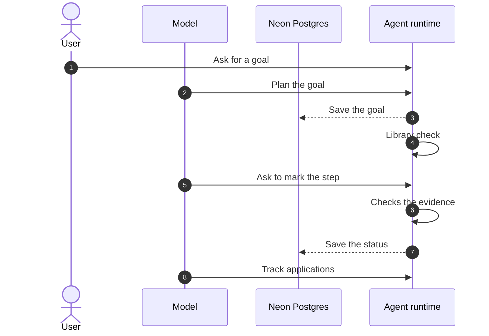

# How a goal step advances

Mapped: 2026-11-22 · Mapped by Alex from the code

A goal is planned as steps, and a step only moves forward when a tool did real work in the same turn. The agent runtime enforces this on the server.

**Starts when:** The user types a goal on the Goals page, or asks Muse to move a goal forward from chat or the Goals page.

## Steps

| # | From → To | What happens | Code |
|---|---|---|---|
| 1 | User → Agent runtime | Submits a goal or a nudge, which is sent as a normal chat message · `POST /api/agent/turn` | [goals/goals.js](../../../public/js/features/goals/goals.js) |
| 2 | Model → Agent runtime | Plans the goal with 3 to 6 steps and an optional target and deadline · `create_goal` | [tools/goals.js:27](../../../server/agent/tools/goals.js#L27) |
| 3 | Agent runtime → Neon Postgres | Saves the goal through the goals handler · `createGoal` | [repo.js:25](../../../server/agent/repo.js#L25), [server/goals.js](../../../server/goals.js) |
| 4 | Agent runtime | For a résumé step the user wants moved forward, checks the Library first and marks the step done only if a document matches | [runtime.js:272-282](../../../server/agent/runtime.js#L272-L282) |
| 5 | Model → Agent runtime | Runs a real tool for the step, then asks to mark it, naming the tool as evidence · `update_step` | [tools/goals.js:46](../../../server/agent/tools/goals.js#L46) |
| 6 | Agent runtime | Refuses doing or done unless a non-bookkeeping tool ran this turn and matches the evidence | [tools/goals.js:57](../../../server/agent/tools/goals.js#L57) |
| 7 | Agent runtime → Neon Postgres | Saves the accepted status; the user can also click a step on the Goals page · `updateGoal` | [repo.js:27](../../../server/agent/repo.js#L27), [server/goals.js](../../../server/goals.js) |
| 8 | Model → Agent runtime | Records job applications; applied needs an approved Submit click or a confirmation email this turn · `track_application` | [tools/goals.js:87](../../../server/agent/tools/goals.js#L87), [tools/goals.js:104](../../../server/agent/tools/goals.js#L104) |

## When it goes wrong

- The goals API returns 400 for a missing goal, no steps, a bad status, an unknown step or an invalid application. It returns 404 for an unknown goal and 405 for unsupported methods.
- update_step throws a refusal that tells the model to do the work with a tool first or cite the right tool.
- track_application refuses a status the turn's actions do not prove, or moving a status backward. The model is told to ask the user to click the status on the Goals page.
- If the Library has no résumé, the shortcut replies that it could not verify the step and asks the user to add one or click the step.
- If the user declines or does not answer an approval for interview or offer, nothing is saved.

## Features it serves

- [Goals](../../specs/goals.md)
- [Approvals](../../specs/tool-approvals.md)

