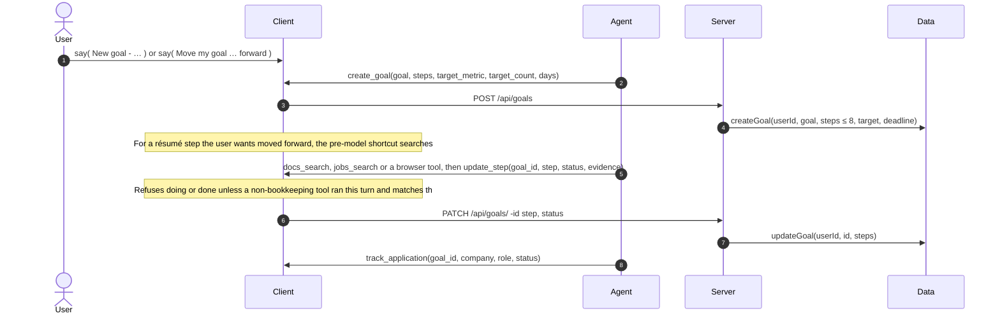

# How a goal step advances

Repository: https://github.com/lngsa1234/mini-muse-mvp · Mapped: 2026-11-18 · Mapped by Alex from the code

Muse creates a goal with a plan and moves a step to doing or done only when a tool did that step's work in the same turn. Application statuses are checked against proof in the same way.

**Starts when:** The user types a goal on the Goals page, or asks Muse to move a goal forward from chat or the Goals page.

## Steps

| # | Who | What happens | Hands to | Code |
|---|---|---|---|---|
| 1 | User | Submits a goal or a nudge, which is sent as a normal chat message. | Client: `say("New goal: …") or say("Move my goal … forward")` | `public/js/features/goals/goals.js` |
| 2 | Agent | Plans the goal with 3 to 6 steps and an optional measurable target and deadline. | Client: `create_goal(goal, steps, target_metric, target_count, days)` | `public/js/features/goals/goals.js` |
| 3 | Client | Saves the goal through the goals API. | Server: `POST /api/goals` | `public/js/core/api.js`, `api/goals/index.js` |
| 4 | Server | Rejects a missing goal or steps and invalid target or deadline with 400. Otherwise stores the goal and returns 201. | Data: `createGoal(userId, goal, steps ≤ 8, target, deadline)` | `server/goals.js`, `server/db.js` |
| 5 | Client | For a résumé step the user wants moved forward, the pre-model shortcut searches the Library and marks the step done only if a document matches. |  | `public/js/agent/run.js` |
| 6 | Agent | Runs a real tool for the step, then asks to mark it, naming the tool as evidence. | Client: `docs_search, jobs_search or a browser tool, then update_step(goal_id, step, status, evidence)` | `public/js/features/goals/goals.js` |
| 7 | Client | Refuses doing or done unless a non-bookkeeping tool ran this turn and matches the cited evidence. Résumé steps need a docs_search that found a document. |  | `public/js/features/goals/goals.js` |
| 8 | Client | Saves the accepted step status. The user can also click a step to mark it done or undo it. | Server: `PATCH /api/goals/:id { step, status }` | `public/js/core/api.js`, `api/goals/[id].js` |
| 9 | Server | Validates the status and step number and stores the updated steps. | Data: `updateGoal(userId, id, steps)` | `server/goals.js`, `server/db.js` |
| 10 | Agent | Records job applications. The client accepts drafted only after docs_add, and applied only after an approved Submit click or a Gmail confirmation email. Interview, offer and rejected need an employer email found in Gmail. | Client: `track_application(goal_id, company, role, status)` | `public/js/features/goals/goals.js` |

## When it goes wrong

- The goals API returns 400 for a missing goal, no steps, a bad status, an unknown step or an invalid application. It returns 404 for an unknown goal and 405 for unsupported methods.
- update_step throws a refusal that tells the model to do the work with a tool first or cite the right tool.
- track_application refuses a status the turn's actions do not prove, or moving a status backward. The model is told to ask the user to click the status on the Goals page.
- If the Library has no résumé, the shortcut replies that it could not verify the step and asks the user to add one or click the step.
- If the user declines or does not answer an approval for interview or offer, nothing is saved.

## Use cases it carries out

- [goals/UC-1](../../use-cases/goals/uc-1-capture-a-goal-and-have-muse-plan-it.md)
- [goals/UC-2](../../use-cases/goals/uc-2-muse-works-through-goal-steps.md)
- [goals/UC-3](../../use-cases/goals/uc-3-verify-step-progress-with-tool-evidence.md)
- [goals/UC-4](../../use-cases/goals/uc-4-set-a-measurable-target-and-deadline.md)
- [goals/UC-5](../../use-cases/goals/uc-5-track-job-applications-with-proof.md)
- [goals/UC-6](../../use-cases/goals/uc-6-revise-a-plan-with-approval.md)
