# How Google connectors sign in

Repository: https://github.com/lngsa1234/mini-muse-mvp · Mapped: 2026-11-18 · Mapped by Alex from the code

Gmail and Calendar share one Google sign-in. The server keeps the tokens in a cookie, and the browser only learns whether Google is connected.

**Starts when:** The user clicks Connect on the Gmail or Calendar card.

```mermaid
flowchart TB
  start(["The user clicks Connect on the Gmail or Calendar card."])
  s1["1. User<br/>Clicks Connect and reads the consent panel listing what Muse can do."]
  s2["2. Client<br/>Continue with Google sends the browser to the authorize endpoint."]
  s3["3. Server<br/>The Google route adapter passes the request to the authorize handler, which redirects the user to Google."]
  s4["4. External<br/>Google asks for consent and redirects back to the callback."]
  s5["5. Server<br/>The callback handler exchanges the code and sets the tokens in an HttpOnly cookie. Tokens never go to browser storage or the model."]
  s6["6. Client<br/>At boot and after the redirect, initConnectors reads the status endpoint and turns Gmail and Calendar on or off together."]
  s7["7. Client<br/>When connected, the mail and calendar tools are added to the agent's tool list on the next turn. Each tool calls the matching Google route, and writes go through approval."]
  s8["8. User<br/>Can disconnect. The client calls the disconnect endpoint, turns the connectors off and records an audit entry."]
  start --> s1
  s1 --> s2
  s2 --> s3
  s3 --> s4
  s4 --> s5
  s5 --> s6
  s6 --> s7
  s7 --> s8
  classDef user fill:#F1EFE8,stroke:#5F5E5A,color:#2C2C2A
  classDef agent fill:#EEEDFE,stroke:#534AB7,color:#26215C
  classDef client fill:#E1F5FE,stroke:#0E7490,color:#164E63
  classDef server fill:#E1F5EE,stroke:#0F6E56,color:#04342C
  classDef data fill:#F3E8FF,stroke:#7E22CE,color:#3B0764
  classDef external fill:#FAEEDA,stroke:#854F0B,color:#412402
  class s1 user
  class s2 client
  class s3 server
  class s4 external
  class s5 server
  class s6 client
  class s7 client
  class s8 user
```

## Steps

| # | Who | What happens | Code |
|---|---|---|---|
| 1 | User | Clicks Connect and reads the consent panel listing what Muse can do. | `public/js/features/connectors/index.js` |
| 2 | Client | Continue with Google sends the browser to the authorize endpoint. | `public/js/features/connectors/index.js` |
| 3 | Server | The Google route adapter passes the request to the authorize handler, which redirects the user to Google. | `server/google-route.js`, `server/google.js` |
| 4 | External | Google asks for consent and redirects back to the callback. |  |
| 5 | Server | The callback handler exchanges the code and sets the tokens in an HttpOnly cookie. Tokens never go to browser storage or the model. | `server/google-route.js`, `server/google.js` |
| 6 | Client | At boot and after the redirect, initConnectors reads the status endpoint and turns Gmail and Calendar on or off together. | `public/js/features/connectors/index.js` |
| 7 | Client | When connected, the mail and calendar tools are added to the agent's tool list on the next turn. Each tool calls the matching Google route, and writes go through approval. | `public/js/agent/tools.js`, `public/js/features/connectors/mail.js` |
| 8 | User | Can disconnect. The client calls the disconnect endpoint, turns the connectors off and records an audit entry. | `public/js/features/connectors/index.js` |
