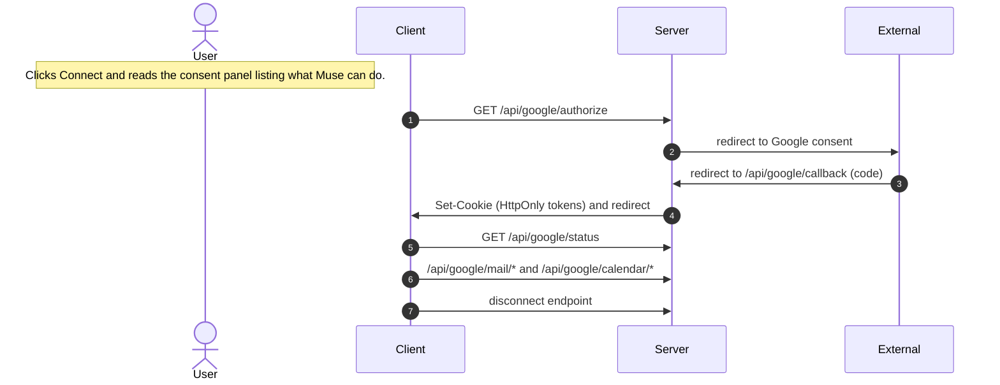

# How Google connectors sign in

Repository: https://github.com/lngsa1234/mini-muse-mvp · Mapped: 2026-11-18 · Mapped by Alex from the code

Gmail and Calendar share one Google sign-in. The server keeps the tokens in an HttpOnly cookie, and the browser only learns whether Google is connected.

**Starts when:** The user clicks Connect on the Gmail or Calendar card.

## Steps

| # | Who | What happens | Hands to | Code |
|---|---|---|---|---|
| 1 | User | Clicks Connect and reads the consent panel listing what Muse can do. |  | `public/js/features/connectors/index.js` |
| 2 | Client | Continue with Google navigates the browser to the authorize endpoint. | Server: `GET /api/google/authorize` | `public/js/features/connectors/index.js` |
| 3 | Server | The Google route adapter calls the authorize handler, which redirects to Google. | External: `redirect to Google consent` | `server/google-route.js`, `server/google.js` |
| 4 | External | Google asks for consent and redirects back. | Server: `redirect to /api/google/callback (code)` |  |
| 5 | Server | The callback handler exchanges the code and sets the tokens in a cookie. | Client: `Set-Cookie (HttpOnly tokens) and redirect` | `server/google-route.js`, `server/google.js` |
| 6 | Client | At boot and after the redirect, initConnectors asks whether Google is connected and turns Gmail and Calendar on or off together. | Server: `GET /api/google/status` | `public/js/features/connectors/index.js`, `public/js/core/api.js` |
| 7 | Client | When connected, the mail and calendar tools join the agent's tool list. Each tool calls its Google route, and writes go through approval. | Server: `/api/google/mail/* and /api/google/calendar/*` | `public/js/agent/tools.js`, `public/js/features/connectors/mail.js`, `server/google-route.js` |
| 8 | Client | On Disconnect Google, calls the endpoint, turns both connectors off and records an audit entry. | Server: `disconnect endpoint` | `public/js/features/connectors/index.js` |

## When it goes wrong

- If the status call fails, both Google connectors are set off.
- The Google route adapter turns a thrown error into a JSON error with its status, or 500, and keeps any cookie the error carries. Unknown actions return 404.
- The disconnect call's failure is ignored, and the connectors are still turned off locally.
