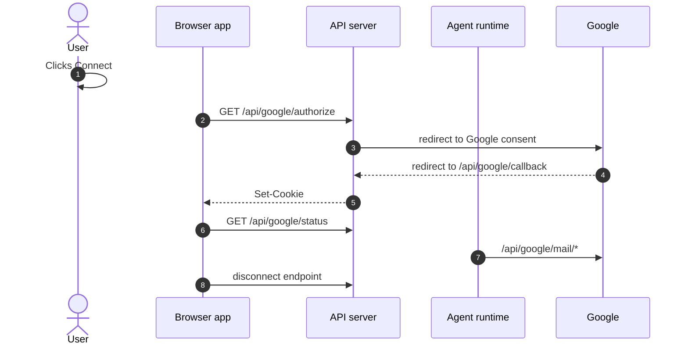

# How Google connectors sign in

Mapped: 2026-11-22 · Mapped by Alex from the code

Gmail and Calendar share one Google sign-in. The server keeps the tokens in an HttpOnly cookie, and the browser only learns whether Google is connected.

**Starts when:** The user clicks Connect on the Gmail or Calendar card.

## Steps

| # | From → To | What happens | Code |
|---|---|---|---|
| 1 | User | Clicks Connect and reads the consent panel listing what Muse can do | [connectors/index.js](../../../public/js/features/connectors/index.js) |
| 2 | Browser app → API server | Continue with Google navigates the browser to the authorize endpoint · `GET /api/google/authorize` | [connectors/index.js](../../../public/js/features/connectors/index.js) |
| 3 | API server → Google | The Google route adapter calls the authorize handler, which redirects to Google · `redirect to Google consent` | [google-route.js](../../../server/google-route.js), [google.js](../../../server/google.js) |
| 4 | Google → API server | Google asks for consent and redirects back · `redirect to /api/google/callback (code)` |  |
| 5 | API server → Browser app | The callback handler exchanges the code and sets the tokens in a cookie · `Set-Cookie (…) and redirect` | [google-route.js](../../../server/google-route.js), [google.js](../../../server/google.js) |
| 6 | Browser app → API server | At boot and after the redirect, initConnectors asks whether Google is connected and turns Gmail and Calendar on or off together · `GET /api/google/status` | [connectors/index.js](../../../public/js/features/connectors/index.js), [api.js](../../../public/js/core/api.js) |
| 7 | Agent runtime → Google | When connected, the mail and calendar tools join the agent’s tools on the server and call Google with the tokens from the cookie; writes go through approval · `/api/google/mail/* and /api/google/calendar/*` | [connectors.js](../../../server/agent/tools/connectors.js), [google-route.js](../../../server/google-route.js) |
| 8 | Browser app → API server | On Disconnect Google, calls the endpoint, turns both connectors off and records an audit entry · `disconnect endpoint` | [connectors/index.js](../../../public/js/features/connectors/index.js) |

## When it goes wrong

- If the status call fails, both Google connectors are set off.
- The Google route adapter turns a thrown error into a JSON error with its status, or 500, and keeps any cookie the error carries. Unknown actions return 404.
- The disconnect call's failure is ignored, and the connectors are still turned off locally.

## Features it serves

- [Connectors](../../specs/connectors.md)

