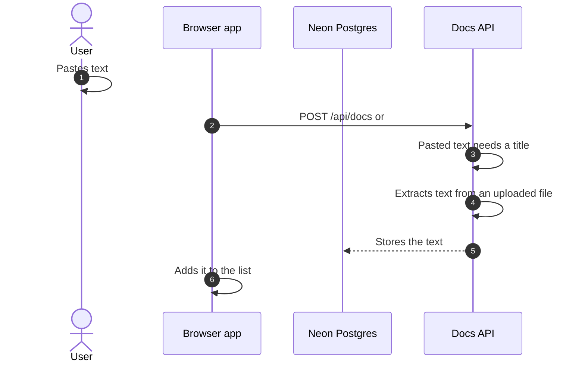

# How documents enter the Library

Mapped: 2026-11-22 · Mapped by Alex from the code

A user pastes text or uploads a file. The server stores only the extracted text, and the agent can then search and cite it.

**Starts when:** The user submits the Library form, or Muse calls docs_add.

## Steps

| # | From → To | What happens | Code |
|---|---|---|---|
| 1 | User | Pastes text with a title or chooses a file such as a PDF, DOCX or TXT |  |
| 2 | Browser app → Docs API | Sends the text or the base64 file. The docs_add tool does the same for text Muse saves · `POST /api/docs (title, text) or (…)` | [library/library.js](../../../public/js/features/library/library.js), [docs/index.js](../../../api/docs/index.js) |
| 3 | Docs API | Pasted text needs a title and text and is cut to 60,000 characters. Files are decoded and checked for empty or over 3MB | [docs.js](../../../server/docs.js) |
| 4 | Docs API | Extracts text from an uploaded file. The filename without its extension is the default title | [docs.js](../../../server/docs.js), [extract.js](../../../server/extract.js) |
| 5 | Docs API → Neon Postgres | Stores the document text for the user in Postgres. The original file is not kept. Returns 201 with the doc · `createDoc(userId, title, text)` | [docs.js](../../../server/docs.js), [db.js](../../../server/db.js) |
| 6 | Browser app | Adds the document to the list on the page; the docs_search and docs_read tools on the server read it from Postgres | [library/library.js](../../../public/js/features/library/library.js), [tools/library.js](../../../server/agent/tools/library.js) |

## When it goes wrong

- A missing title or text returns 400. An empty or undecodable file returns 400.
- A file over 3MB returns 413.
- A file with no extractable text returns 422.
- Delete returns 404 for an unknown document. Unsupported methods return 405.

## Features it serves

- [Library](../../specs/library.md)
- [Goals](../../specs/goals.md)

