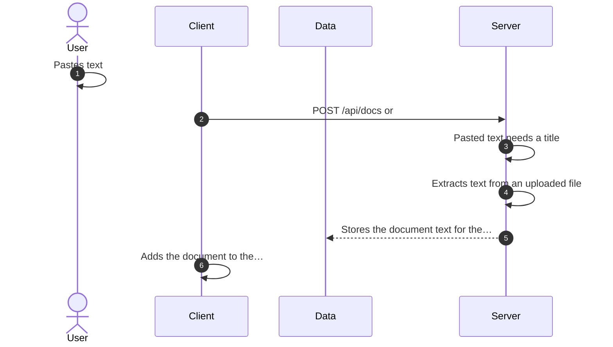

# How documents enter the Library

Mapped: 2026-11-21 · Mapped by Alex from the code

A user pastes text or uploads a file. The server stores only the extracted text, and the agent can then search and cite it.

**Starts when:** The user submits the Library form, or Muse calls docs_add.

## Steps

| # | Who | What happens | Hands to | Code |
|---|---|---|---|---|
| 1 | User | Pastes text with a title or chooses a file such as a PDF, DOCX or TXT. |  |  |
| 2 | Client | Sends the text or the base64 file. The docs_add tool does the same for text Muse saves. | Server: `POST /api/docs (title, text) or (filename, contentType, dataBase64)` | `public/js/features/library/library.js`, `api/docs/index.js` |
| 3 | Server | Pasted text needs a title and text and is cut to 60,000 characters. Files are decoded and checked for empty or over 3MB. |  | `server/docs.js` |
| 4 | Server | Extracts text from an uploaded file. The filename without its extension is the default title. |  | `server/docs.js`, `server/extract.js` |
| 5 | Server | Stores the document text for the user in Postgres. The original file is not kept. Returns 201 with the doc. | Data: `createDoc(userId, title, text)` | `server/docs.js`, `server/db.js` |
| 6 | Client | Adds the document to the in-memory list so the page and the docs_search and docs_read tools can use it. |  | `public/js/features/library/library.js`, `public/js/features/library/search.js` |

## When it goes wrong

- A missing title or text returns 400. An empty or undecodable file returns 400.
- A file over 3MB returns 413.
- A file with no extractable text returns 422.
- Delete returns 404 for an unknown document. Unsupported methods return 405.

## Features it serves

- [Library](../../specs/library.md)
- [Goals](../../specs/goals.md)

