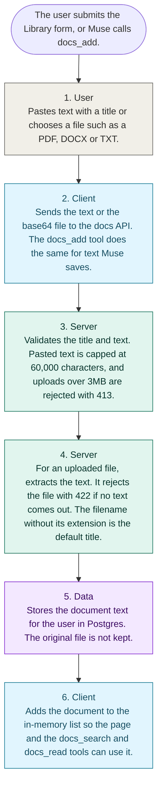

# How documents enter the Library

Repository: https://github.com/lngsa1234/mini-muse-mvp · Mapped: 2026-11-18 · Mapped by Alex from the code

A user pastes text or uploads a file. The server keeps only the extracted text, and the agent can then search and cite it.

**Starts when:** The user submits the Library form, or Muse calls docs_add.

## Steps

| # | Who | What happens | Code |
|---|---|---|---|
| 1 | User | Pastes text with a title or chooses a file such as a PDF, DOCX or TXT. | `public/js/features/library/library.js` |
| 2 | Client | Sends the text or the base64 file to the docs API. The docs_add tool does the same for text Muse saves. | `public/js/features/library/library.js` |
| 3 | Server | Validates the title and text. Pasted text is capped at 60,000 characters, and uploads over 3MB are rejected with 413. | `server/docs.js` |
| 4 | Server | For an uploaded file, extracts the text. It rejects the file with 422 if no text comes out. The filename without its extension is the default title. | `server/docs.js`, `server/extract.js` |
| 5 | Data | Stores the document text for the user in Postgres. The original file is not kept. | `server/db.js` |
| 6 | Client | Adds the document to the in-memory list so the page and the docs_search and docs_read tools can use it. | `public/js/features/library/library.js` |

## Use cases it carries out

- [goals/UC-3](../../use-cases/goals/uc-3-verify-step-progress-with-tool-evidence.md)
