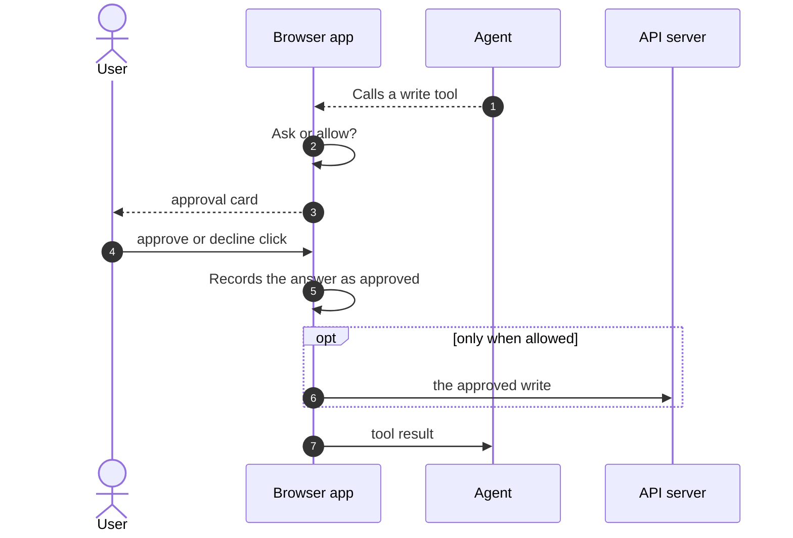

# How sensitive actions get approval

Mapped: 2026-11-22 · Mapped by Alex from the code

A tool that changes something pauses the turn and shows an approval card in chat. It continues only after the user answers.

**Starts when:** The model calls a tool that asks for approval, such as mail_send, a write on Calendar or Contacts with Ask me first, revise_plan, or marking an interview or offer.

## Steps

| # | From → To | What happens | Code |
|---|---|---|---|
| 1 | Agent → Browser app | Requests a write tool during the loop. The tool is wrapped to log activity, trace it and show progress · `tool.execute(input)` | [loop.js](../../../public/js/agent/loop.js), [tools.js](../../../public/js/agent/tools.js) |
| 2 | Browser app | Checks whether the connector needs approval. Gmail is always locked to ask, and others follow the user's Ask or Allow setting | [tools.js](../../../public/js/agent/tools.js) |
| 3 | Browser app → User | Switches to chat, shows a pending approval card, and waits · `approval card (…)` | [approvals.js](../../../public/js/workflow/approvals.js) |
| 4 | User → Browser app | ✋ Allows or declines the action · `approve or decline click` |  |
| 5 | Browser app | Records the answer as approved, declined or expired, and writes an audit entry | [approvals.js](../../../public/js/workflow/approvals.js) |
| 6 | Browser app → API server | _Only when allowed:_ Performs the change only if the answer was approved · `the approved write, such as the mail send route or goals API` | [goals.js](../../../public/js/features/goals/goals.js), [google-route.js](../../../server/google-route.js) |
| 7 | Browser app → Agent | Returns the result to the model, or 'Nothing was changed' if declined or unanswered · `tool result` | [tools.js](../../../public/js/agent/tools.js) |

✋ The step waits for the user.

## When it goes wrong

- A decline returns 'The user declined. Nothing was changed.' to the model.
- If the user does not answer before the turn ends, or presses Stop, the approval resolves as no answer and returns 'The user did not answer. Nothing was changed.'

## Features it serves

- [Approvals](../../specs/tool-approvals.md)
- [Connectors](../../specs/connectors.md)
- [Goals](../../specs/goals.md)

