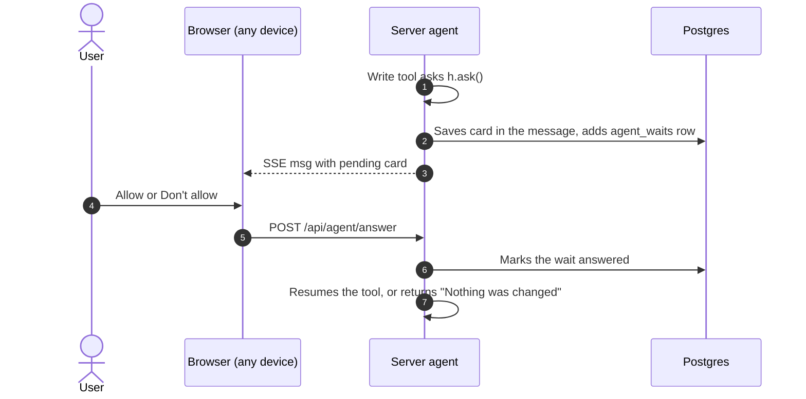

# How sensitive actions get approval

Repository: https://github.com/lngsa1234/mini-muse-project · Updated: 2026-11-20 for [ADR-0009](../../adr/0009-run-the-agent-loop-on-the-server.md)

A tool that changes something pauses the turn on the server and saves an approval card in the chat message. The turn continues only after the user answers, from any device showing the chat.

**Starts when:** The model calls a tool that asks for approval: mail_send, a write on Calendar or Contacts with Ask me first, revise_plan, browser_click, or marking an interview or offer.

## Steps

| # | Who | What happens | Hands to | Code |
|---|---|---|---|---|
| 1 | Server | A write tool checks whether it needs approval. Gmail always asks; Calendar and Contacts follow the user's Ask or Allow setting. |  | `server/agent/tools/connectors.js`, `server/agent/tools/goals.js`, `server/agent/tools/browser.js` |
| 2 | Server | Adds a pending card to the message, saves it, and creates an `agent_waits` row with the card's id. | Browser: `SSE msg` | `server/agent/runtime.js` |
| 3 | Browser | Shows the card. Another device shows it too, after loading the chat. | User: `approval card` | `public/js/features/chat/chat.js` |
| 4 | User | Allows or declines. | Browser: `approve or decline click` | `public/js/workflow/approvals.js` |
| 5 | Browser | Posts the answer. Only a pending wait can be answered, so a second answer gets 409. | Server: `POST /api/agent/answer` | `server/agent/http.js` |
| 6 | Server | The waiting turn wakes (in-process, or by polling the database on another instance), records the answer and an audit entry, and runs the change only if approved. |  | `server/agent/runtime.js` |
| 7 | Server | Returns the result to the model, or 'Nothing was changed' if declined or unanswered. |  | `server/agent/runtime.js` |

## When it goes wrong

- A decline returns 'The user declined. Nothing was changed.' to the model.
- No answer within `AGENT_APPROVAL_TIMEOUT_MS` (4 minutes by default), or Stop, expires the card and returns 'The user did not answer. Nothing was changed.'
- A Chrome-bridge tool (browser_*) runs in the tab that started the turn. If that tab doesn't answer within 45 seconds, the tool returns an error and the model is told not to retry browser tools.

## Use cases it carries out

- [goals/UC-6](../../use-cases/goals/uc-6-revise-a-plan-with-approval.md)
