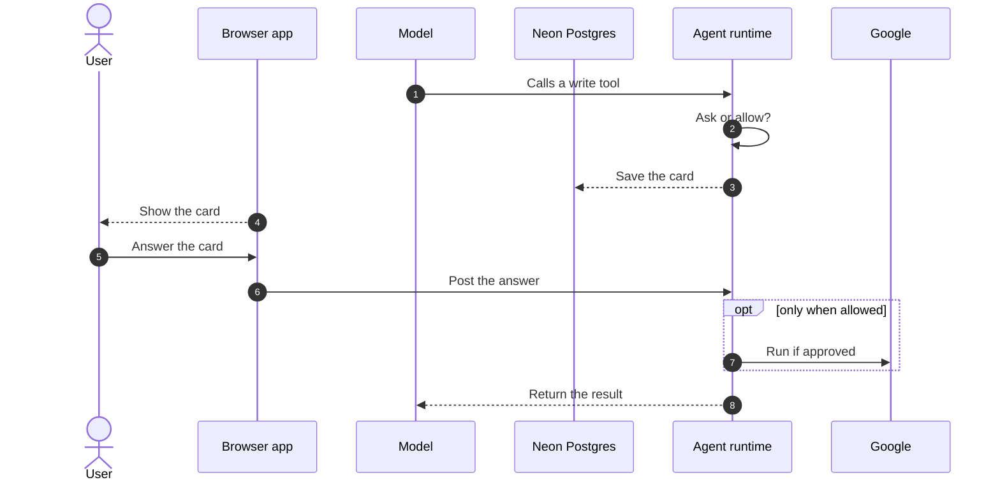

# How sensitive actions get approval

Mapped: 2026-11-22 · Mapped by Alex from the code

Before a tool changes or sends something, the agent runtime saves an approval card and waits. The user answers on any device; the change runs only if they approved.

**Starts when:** The model calls a tool that writes, such as sending an email, adding a calendar event or revising a goal

## Steps

| # | From → To | What happens | Code |
|---|---|---|---|
| 1 | Model → Agent runtime | Calls a write tool | [connectors.js](../../../server/agent/tools/connectors.js), [goals.js](../../../server/agent/tools/goals.js) |
| 2 | Agent runtime | Checks whether it needs approval: Gmail always asks; Calendar and Contacts follow the user’s Ask or Allow setting | [connectors.js](../../../server/agent/tools/connectors.js) |
| 3 | Agent runtime → Neon Postgres | Adds a pending card to the reply, saves it and creates a wait record · `agent_waits` | [runtime.js](../../../server/agent/runtime.js) |
| 4 | Browser app → User | Shows the card; another device shows it too after loading the chat · `approval card` | [chat.js](../../../public/js/features/chat/chat.js) |
| 5 | User → Browser app | ✋ Allows or declines the action · `approve or decline` | [approvals.js:24-25](../../../public/js/workflow/approvals.js#L24-L25) |
| 6 | Browser app → Agent runtime | Posts the answer; only a pending wait can be answered, so a second answer gets 409 · `POST /api/agent/answer` | [approvals.js](../../../public/js/workflow/approvals.js), [http.js](../../../server/agent/http.js) |
| 7 | Agent runtime → Google | _Only when allowed:_ Wakes the waiting turn, records the answer and an audit entry, and runs the change only if approved · `the approved write, such as mail send` | [runtime.js:48-53](../../../server/agent/runtime.js#L48-L53) |
| 8 | Agent runtime → Model | Returns the result to the model, or Nothing was changed if declined or unanswered · `tool result` | [runtime.js](../../../server/agent/runtime.js) |

✋ The step waits for the user.

## When it goes wrong

- A decline returns “The user declined. Nothing was changed.” to the model.
- No answer within 4 minutes (AGENT_APPROVAL_TIMEOUT_MS), or Stop, expires the card and returns “The user did not answer. Nothing was changed.”

## Features it serves

- [Approvals](../../specs/tool-approvals.md)
- [Connectors](../../specs/connectors.md)
- [Goals](../../specs/goals.md)

