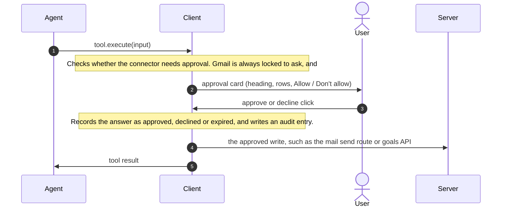

# How sensitive actions get approval

Repository: https://github.com/lngsa1234/mini-muse-mvp · Mapped: 2026-11-18 · Mapped by Alex from the code

A tool that changes something pauses the turn and shows an approval card in chat. It continues only after the user answers.

**Starts when:** The model calls a tool that asks for approval, such as mail_send, a write on Calendar or Contacts with Ask me first, revise_plan, or marking an interview or offer.

## Steps

| # | Who | What happens | Hands to | Code |
|---|---|---|---|---|
| 1 | Agent | Requests a write tool during the loop. The tool is wrapped to log activity, trace it and show progress. | Client: `tool.execute(input)` | `public/js/agent/loop.js`, `public/js/agent/tools.js` |
| 2 | Client | Checks whether the connector needs approval. Gmail is always locked to ask, and others follow the user's Ask or Allow setting. |  | `public/js/agent/tools.js` |
| 3 | Client | Switches to chat, shows a pending approval card, and waits. | User: `approval card (heading, rows, Allow / Don't allow)` | `public/js/workflow/approvals.js` |
| 4 | User | Allows or declines the action. | Client: `approve or decline click` |  |
| 5 | Client | Records the answer as approved, declined or expired, and writes an audit entry. |  | `public/js/workflow/approvals.js` |
| 6 | Client | Performs the change only if the answer was approved. | Server: `the approved write, such as the mail send route or goals API` | `public/js/features/goals/goals.js`, `server/google-route.js` |
| 7 | Client | Returns the result to the model, or 'Nothing was changed' if declined or unanswered. | Agent: `tool result` | `public/js/agent/tools.js` |

## When it goes wrong

- A decline returns 'The user declined. Nothing was changed.' to the model.
- If the user does not answer before the turn ends, or presses Stop, the approval resolves as no answer and returns 'The user did not answer. Nothing was changed.'

## Use cases it carries out

- [goals/UC-6](../../use-cases/goals/uc-6-revise-a-plan-with-approval.md)
