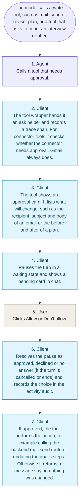

# How sensitive actions get approved

Repository: https://github.com/lngsa1234/mini-muse-mvp · Mapped: 2026-11-18 · Mapped by Alex from the code

A tool that changes something outside the app pauses the turn and shows an approval card in chat. It continues only after the user answers.

**Starts when:** The model calls a write tool, such as mail_send or revise_plan, or a tool that asks to count an interview or offer.

## Steps

| # | Who | What happens | Code |
|---|---|---|---|
| 1 | Agent | Calls a tool that needs approval. | `public/js/agent/loop.js` |
| 2 | Client | The tool wrapper hands it an ask helper and records a trace span. For connector tools it checks whether the connector needs approval. Gmail always does. | `public/js/agent/tools.js` |
| 3 | Client | The tool shows an approval card. It lists what will change, such as the recipient, subject and body of an email or the before and after of a plan. | `public/js/features/connectors/mail.js`, `public/js/features/goals/goals.js` |
| 4 | Client | Pauses the turn in a waiting state and shows a pending card in chat. | `public/js/workflow/approvals.js` |
| 5 | User | Clicks Allow or Don't allow. |  |
| 6 | Client | Resolves the pause as approved, declined or no answer (if the turn is cancelled or ends) and records the choice in the activity audit. | `public/js/workflow/approvals.js` |
| 7 | Client | If approved, the tool performs the action, for example calling the backend mail send route or updating the goal's steps. Otherwise it returns a message saying nothing was changed. | `public/js/features/connectors/mail.js`, `public/js/features/goals/goals.js` |

## Use cases it carries out

- [goals/UC-6](../../use-cases/goals/uc-6-revise-a-plan-with-approval.md)
