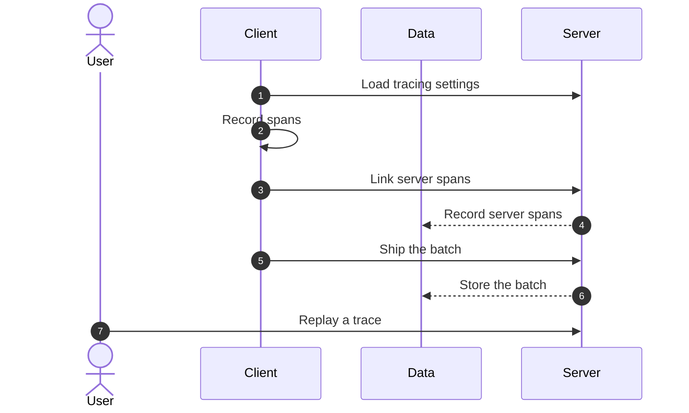

# How turns are traced

Mapped: 2026-11-21 · Mapped by Alex from the code

Each chat turn and model call is recorded as a trace, with prompts, replies and tool inputs and outputs, so the builder can replay it on the Observability page.

**Starts when:** Any chat turn, model call or API request while tracing is on

## Steps

| # | Who | What happens | Hands to | Code |
|---|---|---|---|---|
| 1 | Client | Loads the tracing settings at startup: whether tracing is on, whether to keep prompt and reply text, and the sample rate | Server: `GET /api/trace?view=config` | `public/js/core/trace.js:176-185` |
| 2 | Client | Starts a trace for the turn and records spans for the model call and each tool, keeping text up to the cap or only its length |  | `public/js/core/trace.js:128-139`, `public/js/core/trace.js:40-43` |
| 3 | Client | Sends a traceparent header with model and API calls so the server’s spans join the same trace | Server: `traceparent header` | `public/js/agent/transport.js:11-16`, `public/js/core/api.js:7-12` |
| 4 | Server | Opens a server span for the request and records it under the same trace | Data: `spans` | `server/trace-node.js:71-74` |
| 5 | Client | Sends buffered spans and logs every three seconds, and when the page is hidden or closed | Server: `POST /api/trace` | `public/js/core/trace.js:154-165` |
| 6 | Server | Stamps the signed-in user on traces and logs and writes the batch to Postgres | Data: `insert traces, spans, logs` | `server/trace.js:60-77`, `server/trace-store.js:74-79` |
| 7 | User | Opens the Observability page and a trace, which loads its spans for the waterfall | Server: `GET /api/trace?id=` | `public/js/features/observability/observability.js` |

## When it goes wrong

- Every write is best-effort: a failed config load or flush never breaks the user’s request.
- With OBS_ENABLED off, ingest accepts the batch and writes nothing.
- Reading one trace by id doesn’t check who owns it, so anyone with a trace id can read its prompts and tool outputs.

## Features it serves

- [Observability](../../specs/observability.md)
- [Agent chat](../../specs/agent-chat.md)

