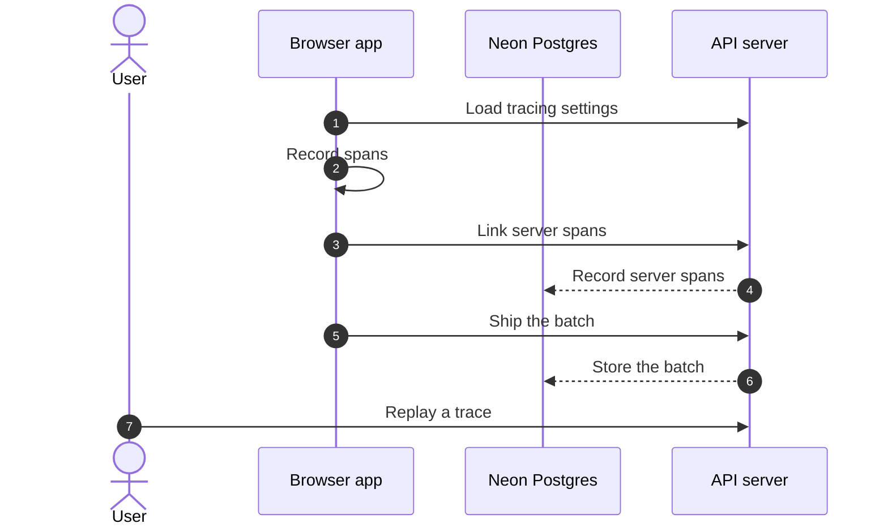

# How turns are traced

Mapped: 2026-11-22 · Mapped by Alex from the code

Each chat turn and model call is recorded as a trace, with prompts, replies and tool inputs and outputs, so the builder can replay it on the Observability page.

**Starts when:** Any chat turn, model call or API request while tracing is on

## Steps

| # | From → To | What happens | Code |
|---|---|---|---|
| 1 | Browser app → API server | Loads the tracing settings at startup: whether tracing is on, whether to keep prompt and reply text, and the sample rate · `GET /api/trace?view=config` | [core/trace.js:176-185](../../../public/js/core/trace.js#L176-L185) |
| 2 | Browser app | Starts a trace for the turn and records spans for the model call and each tool, keeping text up to the cap or only its length | [core/trace.js:128-139](../../../public/js/core/trace.js#L128-L139), [core/trace.js:40-43](../../../public/js/core/trace.js#L40-L43) |
| 3 | Browser app → API server | Sends a traceparent header with model and API calls so the server’s spans join the same trace · `traceparent header` | [transport.js:11-16](../../../public/js/agent/transport.js#L11-L16), [api.js:7-12](../../../public/js/core/api.js#L7-L12) |
| 4 | API server → Neon Postgres | Opens a server span for the request and records it under the same trace · `spans` | [trace-node.js:71-74](../../../server/trace-node.js#L71-L74) |
| 5 | Browser app → API server | Sends buffered spans and logs every three seconds, and when the page is hidden or closed · `POST /api/trace` | [core/trace.js:154-165](../../../public/js/core/trace.js#L154-L165) |
| 6 | API server → Neon Postgres | Stamps the signed-in user on traces and logs and writes the batch to Postgres · `insert traces, spans, logs` | [server/trace.js:60-77](../../../server/trace.js#L60-L77), [trace-store.js:74-79](../../../server/trace-store.js#L74-L79) |
| 7 | User → API server | Opens the Observability page and a trace, which loads its spans for the waterfall · `GET /api/trace?id=` | [observability.js](../../../public/js/features/observability/observability.js) |

## When it goes wrong

- Every write is best-effort: a failed config load or flush never breaks the user’s request.
- With OBS_ENABLED off, ingest accepts the batch and writes nothing.
- Reading one trace by id doesn’t check who owns it, so anyone with a trace id can read its prompts and tool outputs.

## Features it serves

- [Observability](../../specs/observability.md)
- [Agent chat](../../specs/agent-chat.md)

