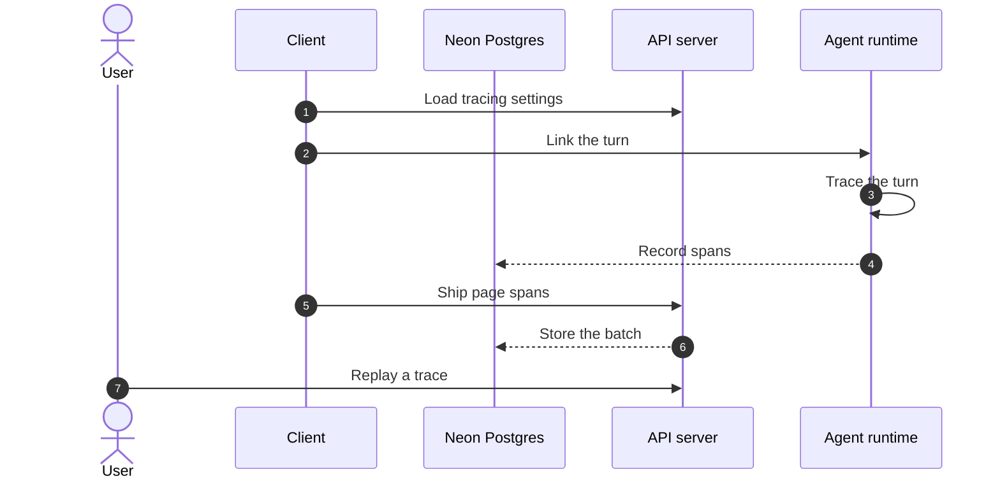

# How turns are traced

Mapped: 2026-11-22 · Mapped by Alex from the code

Each chat turn is recorded as a trace on the server, with the model calls and each tool as spans, so the builder can replay it on the Observability page. The browser still sends its own spans for page activity.

**Starts when:** Any chat turn, model call or API request while tracing is on

## Steps

| # | From → To | What happens | Code |
|---|---|---|---|
| 1 | Client → API server | Loads the tracing settings at startup and starts spans for page activity · `GET /api/trace?view=config` | [core/trace.js:176-185](../../../public/js/core/trace.js#L176-L185), [core/trace.js:128-139](../../../public/js/core/trace.js#L128-L139) |
| 2 | Client → Agent runtime | Sends a traceparent header with the turn request so the server’s spans join the page’s trace · `traceparent header` | [run.js:94-95](../../../public/js/agent/run.js#L94-L95) |
| 3 | Agent runtime | Opens a span for the whole turn | [http.js:64](../../../server/agent/http.js#L64), [trace-node.js:71-74](../../../server/trace-node.js#L71-L74) |
| 4 | Agent runtime → Neon Postgres | Records a span for each model call and tool, keeping text up to the cap or only its length · `spans` | [runtime.js:248](../../../server/agent/runtime.js#L248), [trace-core.js](../../../server/trace-core.js) |
| 5 | Client → API server | Sends buffered page spans and logs every three seconds, and when the page is hidden or closed · `POST /api/trace` | [core/trace.js:154-165](../../../public/js/core/trace.js#L154-L165) |
| 6 | API server → Neon Postgres | Stamps the signed-in user on traces and logs and writes the batch to Postgres · `insert traces, spans, logs` | [server/trace.js:60-77](../../../server/trace.js#L60-L77), [trace-store.js:74-79](../../../server/trace-store.js#L74-L79) |
| 7 | User → API server | Opens the Observability page and a trace, which loads its spans for the waterfall · `GET /api/trace?id=` | [observability.js](../../../public/js/features/observability/observability.js) |

## When it goes wrong

- Every write is best-effort: a failed config load or flush never breaks the user’s request.
- With OBS_ENABLED off, ingest accepts the batch and writes nothing.
- Reading one trace by id doesn’t check who owns it, so anyone with a trace id can read its prompts and tool outputs.

## Features it serves

- [Observability](../../specs/observability.md)
- [Agent chat](../../specs/agent-chat.md)

