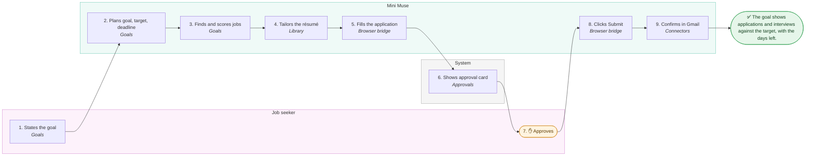
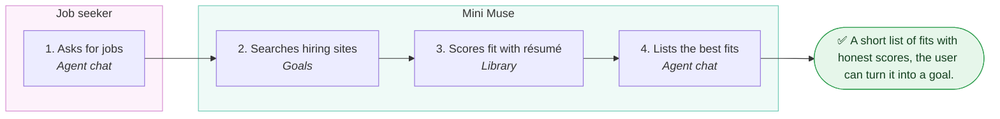
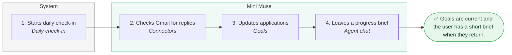
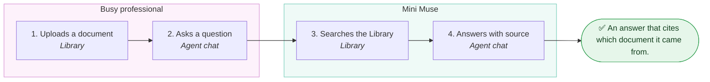
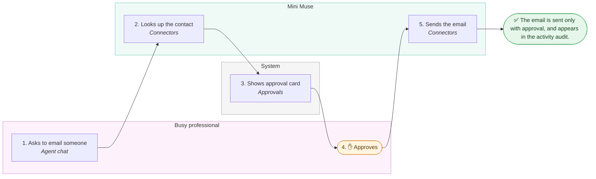
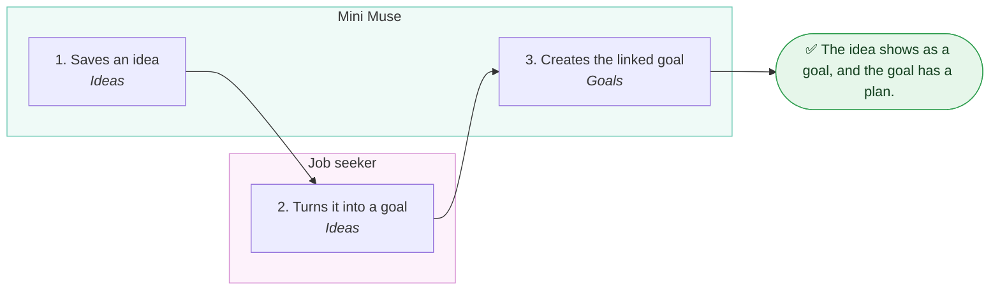

# Mini Muse: product baseline

_What the product is today, written by Maya from the code on 2026-11-25. Each feature's detail is in its spec._

**At a glance:** **3** users · **6** journeys (3 P1, 2 P2, 1 P3) · **13** features · specs: **13** checked against the code, 0 in progress, 0 not written · end-to-end test cases: **17**, 17 automated

## Summary

A personal AI agent you chat with that turns goals into plans and works through them with real tools — your Gmail, calendar, contacts, documents, the web and your Chrome browser — asking before it acts on your behalf and only claiming progress it can prove. Built as a classroom replica of the Muse concept for a learning circle.

## Users

- **Job seeker** — Wants an agent to run a job search with them: find openings, judge fit, prepare applications and track replies against a target.
- **Busy professional** — Wants an assistant that can act across mail, calendar, contacts and documents without doing anything risky unasked.
- **Learning-circle builder** — Wants to see and extend how an agent works: the loop, the tools, approvals and traces.

## Journeys

What users set out to do, end to end. Each journey runs through several features; tap a diagram to zoom in.

| Journey | Priority | Features it runs through |
|---|---|---|
| [J1 Land interviews within a deadline](#j1-land-interviews-within-a-deadline) | P1 | [Goals](../specs/goals.md), [Library](../specs/library.md), [Browser bridge](../specs/browser-bridge.md), [Approvals](../specs/tool-approvals.md), [Connectors](../specs/connectors.md) |
| [J2 Find and judge jobs from chat](#j2-find-and-judge-jobs-from-chat) | P1 | [Agent chat](../specs/agent-chat.md), [Goals](../specs/goals.md), [Library](../specs/library.md) |
| [J3 Let Muse work on my goals while I'm away](#j3-let-muse-work-on-my-goals-while-i-m-away) | P1 | [Daily check-in](../specs/daily-check-in.md), [Connectors](../specs/connectors.md), [Goals](../specs/goals.md), [Agent chat](../specs/agent-chat.md) |
| [J4 Get answers from my own documents](#j4-get-answers-from-my-own-documents) | P2 | [Library](../specs/library.md), [Agent chat](../specs/agent-chat.md) |
| [J5 Email someone without leaving the chat](#j5-email-someone-without-leaving-the-chat) | P2 | [Agent chat](../specs/agent-chat.md), [Connectors](../specs/connectors.md), [Approvals](../specs/tool-approvals.md) |
| [J6 Turn an idea into a goal](#j6-turn-an-idea-into-a-goal) | P3 | [Ideas](../specs/ideas.md), [Goals](../specs/goals.md) |

### J1 Land interviews within a deadline

- **Priority:** P1
- **Who:** Job seeker
- **Goal:** Get a set number of interviews in a month without doing every step alone.
- **Starts when:** The user types a goal like "Land 3 interviews in 30 days" on the Goals page.
- **End-to-end tests:** 4 test cases, 4 automated — ✗ fails

| # | Who | Step | Feature |
|---|---|---|---|
| 1 | Job seeker | States the goal and target roles | [Goals](../specs/goals.md) |
| 2 | Mini Muse | Creates the goal with a plan, a target count and a deadline (create_goal) | [Goals](../specs/goals.md) |
| 3 | Mini Muse | Finds openings on employers' hiring sites (jobs_search) and scores the best against the résumé (score_fit) | [Goals](../specs/goals.md) |
| 4 | Mini Muse | Saves a tailored résumé or cover letter to the Library (docs_add) | [Library](../specs/library.md) |
| 5 | Mini Muse | Fills the chosen application in the user's Chrome tab (browser_fill) | [Browser bridge](../specs/browser-bridge.md) |
| 6 | System | Shows an approval card for the Submit click | [Approvals](../specs/tool-approvals.md) |
| 7 | Job seeker | ✋ Approves: clicks Submit | [Browser bridge](../specs/browser-bridge.md) |
| 8 | Mini Muse | Clicks Submit | [Browser bridge](../specs/browser-bridge.md) |
| 9 | Mini Muse | Finds the confirmation in Gmail and marks the job applied (track_application) | [Connectors](../specs/connectors.md) |

**Done when:** The goal shows applications and interviews against the target, with the days left.

**When it goes wrong:**

- Gmail isn't connected: Muse can't confirm an application and asks the user to click the job's status or connect Gmail.
- No résumé in the Library: score_fit refuses and Muse asks the user to add one.

**End-to-end test cases**

| ID | Test case | Type | Automated test |
|---|---|---|---|
| J1-T1 | Goal to submitted application | Main path | ✓ passes (`e2e/journeys.spec.mjs` › J1 Land interviews within a deadline > J1-T1 goal to submitted application) |
| J1-T2 | Gmail not connected | Failure | ✗ fails (`e2e/journeys.spec.mjs` › J1 Land interviews within a deadline > J1-T2 gmail not connected) |
| J1-T3 | No résumé in the Library | Failure | ✓ passes (`e2e/journeys.spec.mjs` › J1 Land interviews within a deadline > J1-T3 no résumé in the library) |
| J1-T4 | Declining the Submit click | Alternative | ✓ passes (`e2e/journeys.spec.mjs` › J1 Land interviews within a deadline > J1-T4 declining the submit click) |

**J1-T1 Goal to submitted application**

_Given_ A signed-in job seeker with a résumé in the Library, Gmail connected, and the Mini Muse Browser Bridge extension installed in Chrome.

1. On the Goals page, enter "Land 3 interviews in 30 days for product manager roles in Detroit"
2. Pick one of the jobs Muse scores as a strong or possible fit
3. Open the employer's application in Chrome and let Muse fill it
4. Approve the Submit card in chat

_Expect:_

- The goal shows 3 to 6 steps, a target of 3 interviews and 30 days left
- Scored jobs show an overall score, a verdict and missing keywords
- A tailored résumé or cover letter for the job is saved in the Library
- Nothing is submitted before the approval; the card asks whether every field was reviewed
- After approval the job shows as applied and the goal's application count goes up by one

**J1-T2 Gmail not connected**

_Given_ A signed-in job seeker with a résumé in the Library and Gmail not connected, with a job tracked as drafted.

1. Tell Muse in chat "Check whether my application went through"
2. Look at the tracked job on the Goals page

_Expect:_

- Muse asks the user to click the job's status or connect Gmail
- The job is not marked applied

**J1-T3 No résumé in the Library**

_Given_ A signed-in job seeker with an empty Library.

1. On the Goals page, enter "Land 3 interviews in 30 days for product manager roles"
2. Let Muse work on the step that scores jobs

_Expect:_

- Muse asks the user to add a résumé
- No job is shown with a fit score
- The scoring step is not marked done

**J1-T4 Declining the Submit click**

_Given_ A signed-in job seeker with a filled application in a Chrome tab and a Submit approval card showing.

1. Click Don't allow on the Submit card
2. Look at the tracked job on the Goals page

_Expect:_

- The form is not submitted
- The job is not marked applied
- The decline appears in the activity audit

### J2 Find and judge jobs from chat

- **Priority:** P1
- **Who:** Job seeker
- **Goal:** Know which openings are worth applying to, without setting up a goal.
- **Starts when:** The user asks in chat, e.g. "find product manager jobs in Detroit".
- **End-to-end tests:** 3 test cases, 3 automated — ✓ passes

| # | Who | Step | Feature |
|---|---|---|---|
| 1 | Job seeker | Asks Muse for jobs or how well they fit a posting | [Agent chat](../specs/agent-chat.md) |
| 2 | Mini Muse | Searches employers' hiring sites (jobs_search) | [Goals](../specs/goals.md) |
| 3 | Mini Muse | Reads the résumé from the Library and scores fit (score_fit) | [Library](../specs/library.md) |
| 4 | Mini Muse | Lists the strong and possible fits with scores and missing keywords | [Agent chat](../specs/agent-chat.md) |

**Done when:** A short list of fits with honest scores; the user can turn it into a goal.

**When it goes wrong:**

- The user asks for LinkedIn or Indeed: Muse explains it can't search them and uses employers' sites instead.

**End-to-end test cases**

| ID | Test case | Type | Automated test |
|---|---|---|---|
| J2-T1 | Search and score from chat | Main path | ✓ passes (`e2e/journeys.spec.mjs` › J2 Find and judge jobs from chat > J2-T1 search and score from chat) |
| J2-T2 | Asking for LinkedIn or Indeed | Failure | ✓ passes (`e2e/journeys.spec.mjs` › J2 Find and judge jobs from chat > J2-T2 asking for linkedin or indeed) |
| J2-T3 | Fit for one posting | Alternative | ✓ passes (`e2e/journeys.spec.mjs` › J2 Find and judge jobs from chat > J2-T3 fit for one posting) |

**J2-T1 Search and score from chat**

_Given_ A signed-in job seeker with a résumé in the Library and no goals.

1. In chat, type "Find product manager jobs in Detroit"
2. Read Muse's reply

_Expect:_

- The reply lists jobs from employers' hiring sites with a link for each
- Each listed fit shows a score, a verdict and missing keywords
- No goal is created on the Goals page

**J2-T2 Asking for LinkedIn or Indeed**

_Given_ A signed-in job seeker with a résumé in the Library.

1. In chat, type "Search LinkedIn and Indeed for product manager jobs"
2. Read Muse's reply

_Expect:_

- Muse says it can't search LinkedIn or Indeed
- The jobs it lists come from employers' hiring sites

**J2-T3 Fit for one posting**

_Given_ A signed-in job seeker with a résumé in the Library and the link to one job posting.

1. In chat, paste the posting link and ask "How well do I fit this?"
2. Read Muse's reply

_Expect:_

- The reply gives an overall score, a verdict, any dealbreakers and the missing keywords for that posting

### J3 Let Muse work on my goals while I'm away

- **Priority:** P1
- **Who:** Job seeker
- **Goal:** Have progress made and reported every day without asking.
- **Starts when:** Every day after 9am with "Every day" on and the app open, or the check-in button.
- **End-to-end tests:** 3 test cases, 3 automated — ✓ passes

| # | Who | Step | Feature |
|---|---|---|---|
| 1 | System | Starts the check-in once a day | [Daily check-in](../specs/daily-check-in.md) |
| 2 | Mini Muse | Searches Gmail for application confirmations and employer replies (mail_search) | [Connectors](../specs/connectors.md) |
| 3 | Mini Muse | Updates tracked applications the emails prove, and searches for more if behind pace | [Goals](../specs/goals.md) |
| 4 | Mini Muse | Leaves a three-line progress brief and what needs the user's decision | [Agent chat](../specs/agent-chat.md) |

**Done when:** Goals are current and the user has a short brief when they return.

**When it goes wrong:**

- The app is closed: no check-in runs (there is no server-side scheduler yet).

**End-to-end test cases**

| ID | Test case | Type | Automated test |
|---|---|---|---|
| J3-T1 | Daily check-in updates goals | Main path | ✓ passes (`e2e/journeys.spec.mjs` › J3 Let Muse work on my goals while I'm away > J3-T1 daily check-in updates goals) |
| J3-T2 | App closed | Failure | ✓ passes (`e2e/journeys.spec.mjs` › J3 Let Muse work on my goals while I'm away > J3-T2 app closed) |
| J3-T3 | Before 9am | Alternative | ✓ passes (`e2e/journeys.spec.mjs` › J3 Let Muse work on my goals while I'm away > J3-T3 before 9am) |

**J3-T1 Daily check-in updates goals**

_Given_ A signed-in job seeker with a job-search goal, one job tracked as drafted, Gmail connected with that employer's "application received" email, and "Every day" on.

1. Open the Goals page after 9am
2. Wait for the check-in to finish, or click the check-in button

_Expect:_

- Muse leaves a three-line progress brief and lists what needs the user's decision
- The job with the confirmation email shows as applied
- No email is sent during the check-in
- Opening the page again the same day does not start a second check-in

**J3-T2 App closed**

_Given_ A signed-in job seeker with a goal and "Every day" on, with the app closed all day.

1. Keep the app closed past 9am
2. Open the Goals page the next morning before 9am

_Expect:_

- No check-in ran while the app was closed
- No new progress brief from that day is in the chat

**J3-T3 Before 9am**

_Given_ A signed-in job seeker with a goal and "Every day" on, and no check-in yet today.

1. Open the Goals page before 9am
2. Leave it open until after 9am

_Expect:_

- No check-in runs before 9am
- Exactly one check-in runs after 9am

### J4 Get answers from my own documents

- **Priority:** P2
- **Who:** Busy professional
- **Goal:** Ask questions and get answers grounded in my notes, with the source named.
- **Starts when:** The user uploads a document to the Library.
- **End-to-end tests:** 2 test cases, 2 automated — ✓ passes

| # | Who | Step | Feature |
|---|---|---|---|
| 1 | Busy professional | Uploads a file; its text is extracted and stored | [Library](../specs/library.md) |
| 2 | Busy professional | Asks Muse a question in chat | [Agent chat](../specs/agent-chat.md) |
| 3 | Mini Muse | Searches and reads the Library (docs_search, docs_read) | [Library](../specs/library.md) |
| 4 | Mini Muse | Answers and names the document it used | [Agent chat](../specs/agent-chat.md) |

**Done when:** An answer that cites which document it came from.

**End-to-end test cases**

| ID | Test case | Type | Automated test |
|---|---|---|---|
| J4-T1 | Answer cites the document | Main path | ✓ passes (`e2e/journeys.spec.mjs` › J4 Get answers from my own documents > J4-T1 answer cites the document) |
| J4-T2 | File too large or unreadable | Failure | ✓ passes (`e2e/journeys.spec.mjs` › J4 Get answers from my own documents > J4-T2 file too large or unreadable) |

**J4-T1 Answer cites the document**

_Given_ A signed-in user with an empty Library and a text file of meeting notes that mentions a launch date.

1. Upload the notes file on the Library page
2. In chat, ask "When is the launch date in my notes?"

_Expect:_

- The Library lists the document, titled after the file if no title was given
- Muse's answer gives the launch date from the notes and names the document

**J4-T2 File too large or unreadable**

_Given_ A signed-in user with a file over 3MB and a file with no readable text.

1. Upload the file over 3MB
2. Upload the file with no readable text

_Expect:_

- The first upload is refused with "file is too large (max 3MB)"
- The second is refused with "no readable text could be extracted from this file"
- Neither file appears in the Library

### J5 Email someone without leaving the chat

- **Priority:** P2
- **Who:** Busy professional
- **Goal:** Have Muse write and send an email to a contact, safely.
- **Starts when:** The user asks Muse to email someone.
- **End-to-end tests:** 3 test cases, 3 automated — ✓ passes

| # | Who | Step | Feature |
|---|---|---|---|
| 1 | Busy professional | Asks Muse to email a person about something | [Agent chat](../specs/agent-chat.md) |
| 2 | Mini Muse | Looks up the contact (contacts_lookup) | [Connectors](../specs/connectors.md) |
| 3 | System | Shows an approval card with the recipient, subject and body | [Approvals](../specs/tool-approvals.md) |
| 4 | Busy professional | ✋ Approves: sends the email after the user approves (mail_send) | [Connectors](../specs/connectors.md) |
| 5 | Mini Muse | Sends the email after the user approves (mail_send) | [Connectors](../specs/connectors.md) |

**Done when:** The email is sent only with approval, and appears in the activity audit.

**When it goes wrong:**

- The user declines or doesn't answer: nothing is sent and Muse says so.

**End-to-end test cases**

| ID | Test case | Type | Automated test |
|---|---|---|---|
| J5-T1 | Approved email is sent | Main path | ✓ passes (`e2e/journeys.spec.mjs` › J5 Email someone without leaving the chat > J5-T1 approved email is sent) |
| J5-T2 | Declined or unanswered | Failure | ✓ passes (`e2e/journeys.spec.mjs` › J5 Email someone without leaving the chat > J5-T2 declined or unanswered) |
| J5-T3 | Unknown contact | Alternative | ✓ passes (`e2e/journeys.spec.mjs` › J5 Email someone without leaving the chat > J5-T3 unknown contact) |

**J5-T1 Approved email is sent**

_Given_ A signed-in user with Gmail connected and a contact in their contacts.

1. In chat, ask Muse to email that contact about rescheduling Friday's meeting
2. Read the approval card
3. Click Allow

_Expect:_

- The card shows the recipient, subject and body
- Nothing is sent before Allow is clicked
- After Allow the email is sent and the send appears in the activity audit

**J5-T2 Declined or unanswered**

_Given_ A signed-in user with Gmail connected and a contact in their contacts.

1. Ask Muse to email that contact
2. Click Don't allow on the card, or leave it for 4 minutes

_Expect:_

- No email is sent
- Muse says it didn't send it
- The decline or no answer appears in the activity audit

**J5-T3 Unknown contact**

_Given_ A signed-in user with Gmail connected and no contact by the name they use.

1. Ask Muse to email someone who isn't in contacts
2. Read Muse's reply

_Expect:_

- Muse says it found no contact
- No email is sent

### J6 Turn an idea into a goal

- **Priority:** P3
- **Who:** Job seeker
- **Goal:** Act on an idea Muse noticed in conversation.
- **Starts when:** Muse saves an idea while chatting.
- **End-to-end tests:** 2 test cases, 2 automated — ✓ passes

| # | Who | Step | Feature |
|---|---|---|---|
| 1 | Mini Muse | Saves an idea from the conversation (save_idea) | [Ideas](../specs/ideas.md) |
| 2 | Job seeker | Chooses to turn the idea into a goal | [Ideas](../specs/ideas.md) |
| 3 | Mini Muse | Creates the goal linked to the idea (create_goal with idea_id) | [Goals](../specs/goals.md) |

**Done when:** The idea shows as a goal, and the goal has a plan.

**End-to-end test cases**

| ID | Test case | Type | Automated test |
|---|---|---|---|
| J6-T1 | Idea becomes a goal with a plan | Main path | ✓ passes (`e2e/journeys.spec.mjs` › J6 Turn an idea into a goal > J6-T1 idea becomes a goal with a plan) |
| J6-T2 | Same idea twice | Alternative | ✓ passes (`e2e/journeys.spec.mjs` › J6 Turn an idea into a goal > J6-T2 same idea twice) |

**J6-T1 Idea becomes a goal with a plan**

_Given_ A signed-in job seeker with no ideas and no goals.

1. In chat, tell Muse "I should reach out to three former colleagues about PM openings"
2. Open the Ideas page
3. Click Make it a goal on that idea

_Expect:_

- The idea appears on the Ideas page
- A goal with 3 to 6 steps appears on the Goals page, linked to the idea
- The idea shows under Acted on

**J6-T2 Same idea twice**

_Given_ A signed-in user with that idea already on the Ideas page.

1. Share the same idea in chat again
2. Open the Ideas page

_Expect:_

- The idea appears only once

## Features

| Feature | Spec |
|---|---|
| [Agent chat](../specs/agent-chat.md) | ✓ Checked against the code |
| [Approvals](../specs/tool-approvals.md) | ✓ Checked against the code |
| [Goals](../specs/goals.md) | ✓ Checked against the code |
| [Daily check-in](../specs/daily-check-in.md) | ✓ Checked against the code |
| [Ideas](../specs/ideas.md) | ✓ Checked against the code |
| [Library](../specs/library.md) | ✓ Checked against the code |
| [Connectors](../specs/connectors.md) | ✓ Checked against the code |
| [Memory](../specs/memory.md) | ✓ Checked against the code |
| [Web search](../specs/web-search.md) | ✓ Checked against the code |
| [Browser bridge](../specs/browser-bridge.md) | ✓ Checked against the code |
| [Settings](../specs/settings.md) | ✓ Checked against the code |
| [How Muse works](../specs/how-muse-works.md) | ✓ Checked against the code |
| [Observability](../specs/observability.md) | ✓ Checked against the code |

## Gaps and open questions

**Features on no journey:** Memory, Web search, Settings, How Muse works, Observability. Supporting features, or journeys still to write.

- The daily check-in only starts while the app is open (it then runs on the server); is a server-side scheduler planned?
