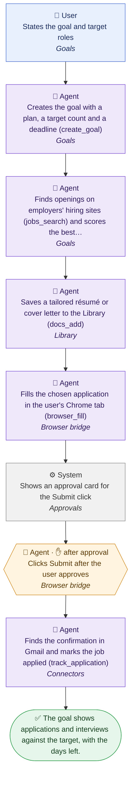
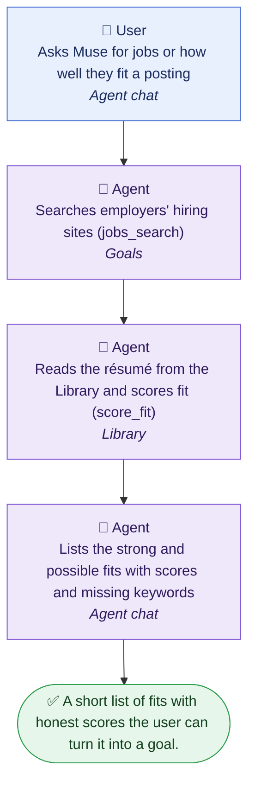
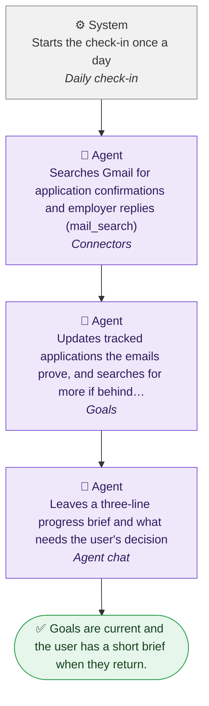
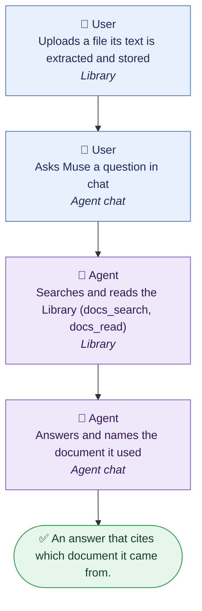
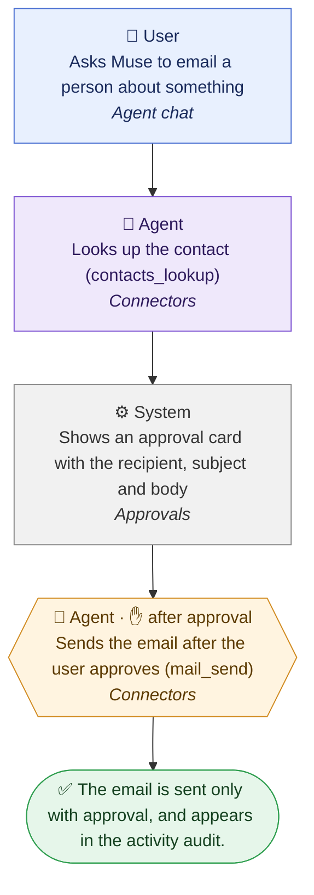
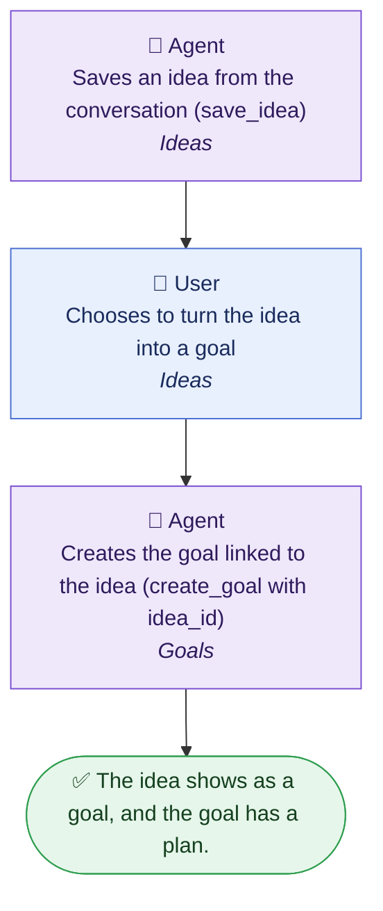

# Mini Muse: product baseline

_What the product is today, written by Maya from the code on 2026-11-21. Each feature's detail is in its spec._

## Summary

A personal AI agent you chat with that turns goals into plans and works through them with real tools — your Gmail, calendar, contacts, documents, the web and your Chrome browser — asking before it acts on your behalf and only claiming progress it can prove. Built as a classroom replica of the Muse concept for a learning circle.

## Users

- **Job seeker** — Wants an agent to run a job search with them: find openings, judge fit, prepare applications and track replies against a target.
- **Busy professional** — Wants an assistant that can act across mail, calendar, contacts and documents without doing anything risky unasked.
- **Learning-circle builder** — Wants to see and extend how an agent works: the loop, the tools, approvals and traces.

## Features

| Feature | Built | Spec |
|---|---|---|
| [Agent chat](../specs/agent-chat.md) | built | not checked |
| [Approvals](../specs/tool-approvals.md) | built | complete |
| [Goals](../specs/goals.md) | built | complete |
| Daily check-in | built | not started |
| [Ideas](../specs/ideas.md) | built | not checked |
| [Library](../specs/library.md) | built | not checked |
| [Connectors](../specs/connectors.md) | built | not checked |
| Memory | built | not started |
| Web search | built | not started |
| Browser bridge | built | not started |
| Settings | built | not started |
| How Muse works | built | not started |
| Observability | built | not started |

## Journeys

| Journey | Priority | Features it runs through |
|---|---|---|
| J1 Land interviews within a deadline | P1 | [Goals](../specs/goals.md), [Library](../specs/library.md), Browser bridge, [Approvals](../specs/tool-approvals.md), [Connectors](../specs/connectors.md) |
| J2 Find and judge jobs from chat | P1 | [Agent chat](../specs/agent-chat.md), [Goals](../specs/goals.md), [Library](../specs/library.md) |
| J3 Let Muse work on my goals while I'm away | P1 | Daily check-in, [Connectors](../specs/connectors.md), [Goals](../specs/goals.md), [Agent chat](../specs/agent-chat.md) |
| J4 Get answers from my own documents | P2 | [Library](../specs/library.md), [Agent chat](../specs/agent-chat.md) |
| J5 Email someone without leaving the chat | P2 | [Agent chat](../specs/agent-chat.md), [Connectors](../specs/connectors.md), [Approvals](../specs/tool-approvals.md) |
| J6 Turn an idea into a goal | P3 | [Ideas](../specs/ideas.md), [Goals](../specs/goals.md) |

### J1 Land interviews within a deadline (P1)

**Who:** Job seeker · **Goal:** Get a set number of interviews in a month without doing every step alone. · **Starts when:** The user types a goal like "Land 3 interviews in 30 days" on the Goals page.

1. **User**: States the goal and target roles — [Goals](../specs/goals.md)
2. **Agent**: Creates the goal with a plan, a target count and a deadline (create_goal) — [Goals](../specs/goals.md)
3. **Agent**: Finds openings on employers' hiring sites (jobs_search) and scores the best against the résumé (score_fit) — [Goals](../specs/goals.md)
4. **Agent**: Saves a tailored résumé or cover letter to the Library (docs_add) — [Library](../specs/library.md)
5. **Agent**: Fills the chosen application in the user's Chrome tab (browser_fill) — Browser bridge
6. **System**: Shows an approval card for the Submit click — [Approvals](../specs/tool-approvals.md)
7. **Agent** _(after the user approves)_: Clicks Submit after the user approves — Browser bridge
8. **Agent**: Finds the confirmation in Gmail and marks the job applied (track_application) — [Connectors](../specs/connectors.md)

**Done when:** The goal shows applications and interviews against the target, with the days left.

**When it goes wrong:**

- Gmail isn't connected: Muse can't confirm an application and asks the user to click the job's status or connect Gmail.
- No résumé in the Library: score_fit refuses and Muse asks the user to add one.

### J2 Find and judge jobs from chat (P1)

**Who:** Job seeker · **Goal:** Know which openings are worth applying to, without setting up a goal. · **Starts when:** The user asks in chat, e.g. "find product manager jobs in Detroit".

1. **User**: Asks Muse for jobs or how well they fit a posting — [Agent chat](../specs/agent-chat.md)
2. **Agent**: Searches employers' hiring sites (jobs_search) — [Goals](../specs/goals.md)
3. **Agent**: Reads the résumé from the Library and scores fit (score_fit) — [Library](../specs/library.md)
4. **Agent**: Lists the strong and possible fits with scores and missing keywords — [Agent chat](../specs/agent-chat.md)

**Done when:** A short list of fits with honest scores; the user can turn it into a goal.

**When it goes wrong:**

- The user asks for LinkedIn or Indeed: Muse explains it can't search them and uses employers' sites instead.

### J3 Let Muse work on my goals while I'm away (P1)

**Who:** Job seeker · **Goal:** Have progress made and reported every day without asking. · **Starts when:** Every day after 9am with "Every day" on and the app open, or the check-in button.

1. **System**: Starts the check-in once a day — Daily check-in
2. **Agent**: Searches Gmail for application confirmations and employer replies (mail_search) — [Connectors](../specs/connectors.md)
3. **Agent**: Updates tracked applications the emails prove, and searches for more if behind pace — [Goals](../specs/goals.md)
4. **Agent**: Leaves a three-line progress brief and what needs the user's decision — [Agent chat](../specs/agent-chat.md)

**Done when:** Goals are current and the user has a short brief when they return.

**When it goes wrong:**

- The app is closed: no check-in runs (there is no server-side scheduler yet).

### J4 Get answers from my own documents (P2)

**Who:** Busy professional · **Goal:** Ask questions and get answers grounded in my notes, with the source named. · **Starts when:** The user uploads a document to the Library.

1. **User**: Uploads a file; its text is extracted and stored — [Library](../specs/library.md)
2. **User**: Asks Muse a question in chat — [Agent chat](../specs/agent-chat.md)
3. **Agent**: Searches and reads the Library (docs_search, docs_read) — [Library](../specs/library.md)
4. **Agent**: Answers and names the document it used — [Agent chat](../specs/agent-chat.md)

**Done when:** An answer that cites which document it came from.

### J5 Email someone without leaving the chat (P2)

**Who:** Busy professional · **Goal:** Have Muse write and send an email to a contact, safely. · **Starts when:** The user asks Muse to email someone.

1. **User**: Asks Muse to email a person about something — [Agent chat](../specs/agent-chat.md)
2. **Agent**: Looks up the contact (contacts_lookup) — [Connectors](../specs/connectors.md)
3. **System**: Shows an approval card with the recipient, subject and body — [Approvals](../specs/tool-approvals.md)
4. **Agent** _(after the user approves)_: Sends the email after the user approves (mail_send) — [Connectors](../specs/connectors.md)

**Done when:** The email is sent only with approval, and appears in the activity audit.

**When it goes wrong:**

- The user declines or doesn't answer: nothing is sent and Muse says so.

### J6 Turn an idea into a goal (P3)

**Who:** Job seeker · **Goal:** Act on an idea Muse noticed in conversation. · **Starts when:** Muse saves an idea while chatting.

1. **Agent**: Saves an idea from the conversation (save_idea) — [Ideas](../specs/ideas.md)
2. **User**: Chooses to turn the idea into a goal — [Ideas](../specs/ideas.md)
3. **Agent**: Creates the goal linked to the idea (create_goal with idea_id) — [Goals](../specs/goals.md)

**Done when:** The idea shows as a goal, and the goal has a plan.

## Not on any journey

Features no journey above uses — supporting features, or journeys still to write:

- Memory
- Web search
- Settings
- How Muse works
- Observability

## Open questions

- The daily check-in only runs while the app is open; is a server-side scheduler planned?
